## 金融経済学の基礎 勉強会

### 第1章　不確実性と危険選好

---

# まえがき：本書の目的と位置づけ

**金融経済学（financial economics）** は，不確実性のもとで取引される金融資産の価格がどのように決まるかを，経済主体の合理的な選択行動から説明する理論である。本書の分析対象は**金融資産市場**であり，消費者は将来の不確実な消費を確保するために証券を売買し，企業は事業資金を証券の発行によって調達する。このとき，

- 不確実な将来に対して消費者はどのように選好を表明し，リスクをどう評価するのか，
- その選好のもとで資産の均衡価格はどのような条件をみたすのか，
- 価格付けの諸理論（資本資産価格モデル，裁定価格理論，確率的割引ファクター）は互いにどう関係するのか，

という問いに答えることが本書の目標となる。

本書では，静学的な**2期間モデル**に限定し，情報の非対称性や市場の摩擦を捨象した**競争的完全市場**を前提とすることで，必要な予備知識を最小限に抑える。

> **動学的内容**：池田昌幸 (2000)『オプション評価と企業金融の理論』東京大学出版会

---

# まえがき：各章の関係（図解）

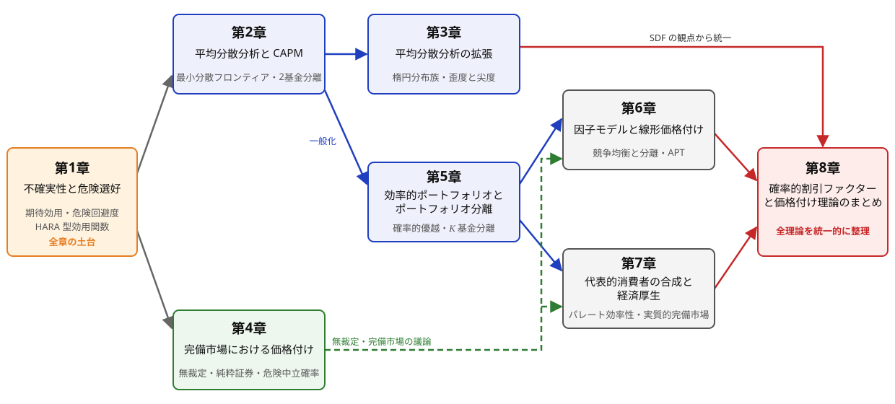

---

# 第1章：本章のねらいと全体像

第1章の目的は，第2章以降の分析に必要な**不確実性下における消費者の選択行動に関する基礎理論**を整理することである。

- **1.1 消費者の選択行動と効用関数**：確実性下の選好を効用関数で表す
- **1.2 期待効用関数**：不確実性下の選好を「効用の期待値」で表す
- **1.3 危険回避と危険プレミアム**：効用関数の「凹凸」で危険回避を表す
- **1.4 絶対的危険回避度と相対的危険回避度**：危険回避の「程度」を測る
- **1.5 危険回避度と危険資産への投資**：危険回避度と消費者の投資行動を結びつける
- **1.6 HARA 型効用関数**：以降の章で頻用される効用関数族を紹介する

---

# 経済の枠組み

- **企業** $j\in\{1,2,\dots,J\}$：利潤の最大化を目的に**財**を生産する。**証券**を発行して事業のための資金を消費者から調達し，証券の保有比率に応じて消費者に利潤を**配当**として分配する。
- **消費者** $i\in\{1,2,\dots,I\}$：財を消費することで自分の欲求を満たすものを想定する。なお，労働所得や相続などにより，あらかじめ消費財や証券を保有していると仮定する。これを**初期賦存量**，その時価を**初期富**という。
  - 初期富を予算として消費を行い，その残余（貯蓄）で証券を購入し企業へ貸し付ける。証券を売買する市場を**金融資産市場**という。証券を保有することで配当により消費のための財を購入する資金が得られるので，証券は**金融資産**とよばれる。
- **財** $m\in\{1,2,\dots,M\}$：正の有限な量が存在して，無限に分割可能とする。消費者は互いに財を交換することができる。ただし不確実性下では，同じ物理的特徴をもつ財でも，**消費の時間が異なれば異なる財**として扱う。

---

# 経済の枠組み（図解）

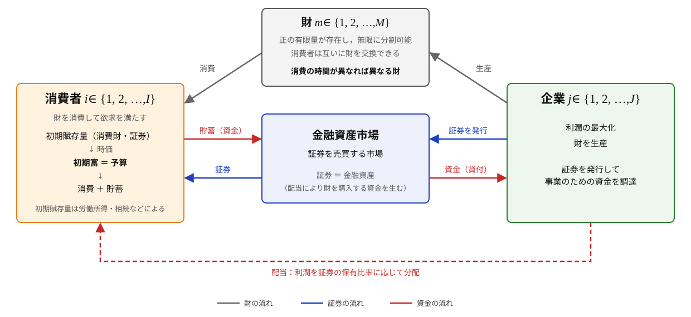

---

# 1.1 消費者の選択行動と効用関数

消費者 $i$ が計画する $M$ 種類の財の消費量をベクトル
$$
\boldsymbol{x}^i=[x^i_1\ x^i_2\ \cdots\ x^i_M]
$$
で表し，これを消費者 $i$ の**消費計画**という。消費者に経済的制約が存在しないとき，実行可能なすべての消費計画の集合を**消費集合**といい，$X^i$ と表す。

以下，誤解のない場合は添え字 $i$ を省略する。

> なお，現実には経済的な制約，すなわち予算による制約が存在する。

消費者 $i$ は，与えられた複数の消費計画のうち，どの消費計画を望ましく考え，どのように順序付けるのか。この選好の順序付けを表す**選好関係** $\succsim^i$ を定義する。

---

**定義（選好関係）**：2つの消費計画 $\boldsymbol{x},\hat{\boldsymbol{x}}\in X$ に対して，
1. $\boldsymbol{x}\succsim\hat{\boldsymbol{x}}$：$\boldsymbol{x}$ を $\hat{\boldsymbol{x}}$ より同等かそれ以上に望ましいと考えていることを表し，$\boldsymbol{x}$ は $\hat{\boldsymbol{x}}$ に対して**弱く選好される**という。
2. $\boldsymbol{x}\sim\hat{\boldsymbol{x}}$：$\boldsymbol{x}\succsim\hat{\boldsymbol{x}}$ かつ $\hat{\boldsymbol{x}}\succsim\boldsymbol{x}$ が成り立つことを表し，$\boldsymbol{x}$ と $\hat{\boldsymbol{x}}$ は**無差別**であるという。
3. $\boldsymbol{x}\succ\hat{\boldsymbol{x}}$：$\boldsymbol{x}\succsim\hat{\boldsymbol{x}}$ は成り立つが $\hat{\boldsymbol{x}}\succsim\boldsymbol{x}$ は成り立たないことを表し，$\boldsymbol{x}$ は $\hat{\boldsymbol{x}}$ に対して**強く選好される**という。

なお，消費計画を構成する各財は，どんなに多くても量が多いほうが少ないほうより選好されるという**非飽和**の仮定を置くことが多い。したがって，資源に関する制約がなければ非飽和な選好を持つ個人は無限の財を消費することになるが，予算制約が存在するので，そのような事態は一般には起こらない。

---

# 選好の公理

標準的なミクロ経済学では，個人の選択行動（意思決定）を合理的に説明するために，次の3つの性質を公理として仮定する。これらの仮定を満たす関係 $\succsim$ を**2項関係**あるいは**前順序**という。

**仮定1（完備性）**：任意の2つの消費計画 $\boldsymbol{x},\hat{\boldsymbol{x}} \in X$ に対して，以下のいずれかが成立する：
$$
\text{(i)}\ \boldsymbol{x}\succsim\hat{\boldsymbol{x}}\qquad
\text{(ii)}\ \hat{\boldsymbol{x}}\succsim\boldsymbol{x}\qquad
\text{(iii)}\ \boldsymbol{x}\sim\hat{\boldsymbol{x}}
$$

**仮定2（推移性）**：任意の3つの消費計画 $\boldsymbol{x},\hat{\boldsymbol{x}},\hat{\hat{\boldsymbol{x}}} \in X$ に対して，
$$
\boldsymbol{x}\succsim\hat{\boldsymbol{x}}\ \text{かつ}\ \hat{\boldsymbol{x}}\succsim\hat{\hat{\boldsymbol{x}}}
\ \Longrightarrow\ 
\boldsymbol{x}\succsim\hat{\hat{\boldsymbol{x}}}
$$

**仮定3（反射性）**：任意の消費計画 $\boldsymbol{x} \in X$ に対して，$\boldsymbol{x}\sim\boldsymbol{x}$ が成り立つ。

- **完備性**：すべての消費計画が比較可能である。
- **推移性**：消費計画に対する比較を繰り返しても矛盾のない順序付けができる。
- **反射性**：同一の消費計画は自分自身と無差別である（完備性で $\hat{\boldsymbol{x}}=\boldsymbol{x}$ とすれば導かれる）。

---

さらに，仮定1〜3に加えて，以下の**技術的仮定**を置く。この仮定は選好の**連続性**ともよばれ，「少しだけ消費計画を変えても選好は急に逆転しない」ことを表す。

**仮定4（技術的仮定）**：任意の消費計画 $\hat{\boldsymbol{x}} \in X$ に対して，

- $\hat{\boldsymbol{x}}$ と同等かそれ以上に選好されるすべての消費計画からなる**優越消費集合** $\{\boldsymbol{x}\mid\boldsymbol{x}\succsim\hat{\boldsymbol{x}}\}$
- $\hat{\boldsymbol{x}}$ より選好されることがないすべての消費計画からなる**劣等消費集合** $\{\boldsymbol{x}\mid\hat{\boldsymbol{x}}\succsim\boldsymbol{x}\}$

は閉集合である。

この仮定から，消費計画 $\hat{\boldsymbol{x}} \in X$ が与えられたとき， $\hat{\boldsymbol{x}}$ と**無差別な消費計画の集合**が定義できる。

---

# 【補足】仮定4の意味について

**定義（閉集合）**：集合 $S\subseteq\mathbb{R}^M$ が**閉集合**であるとは，$S$ 内の点列 $\{\boldsymbol{x}_n\}$ が $n \to \infty$ で $\boldsymbol{x}_n\to \boldsymbol{x}^*$ と収束するならば，必ず $\boldsymbol{x}^*\in S$ となることをいう。

優越消費集合を $U(\hat{\boldsymbol{x}}):=\{\boldsymbol{x}\mid \boldsymbol{x}\succsim \hat{\boldsymbol{x}}\}$，劣等消費集合を $L(\hat{\boldsymbol{x}}):=\{\boldsymbol{x}\mid \hat{\boldsymbol{x}}\succsim \boldsymbol{x}\}$ とおくと，仮定4は次の2条件と同値である：
$$
\boldsymbol{x}_n\succsim \hat{\boldsymbol{x}}\ (\forall n),\ \boldsymbol{x}_n\to \boldsymbol{x}^*\ \Longrightarrow\ \boldsymbol{x}^*\succsim \hat{\boldsymbol{x}}
$$
$$
\hat{\boldsymbol{x}}\succsim \boldsymbol{x}_n\ (\forall n),\ \boldsymbol{x}_n\to \boldsymbol{x}^{**}\ \Longrightarrow\ \hat{\boldsymbol{x}}\succsim \boldsymbol{x}^{**}
$$

ここで，$\hat{\boldsymbol{x}}$ と無差別な消費計画の集合 $I(\hat{\boldsymbol{x}})=\{\boldsymbol{x}\mid \boldsymbol{x}\sim \hat{\boldsymbol{x}}\}=U(\hat{\boldsymbol{x}})\cap L(\hat{\boldsymbol{x}})$ を考える。$I(\hat{\boldsymbol{x}})$ は，2つの閉集合の共通部分なので，$X$ の中で閉集合である。

---

**命題**：優越消費集合の境界上の点は，すべて $\hat{\boldsymbol{x}}$ と無差別である。つまり，
$$
\partial U(\hat{\boldsymbol{x}})\subseteq I(\hat{\boldsymbol{x}})
$$

**証明**：$\boldsymbol{x}^*\in\partial U(\hat{\boldsymbol{x}})$ とする。

- $\boldsymbol{x}^*$ は $U(\hat{\boldsymbol{x}})$ の境界の点なので，$U(\hat{\boldsymbol{x}})$ 内の点列 $\{\boldsymbol{x}_n\}$ で $\boldsymbol{x}_n\to \boldsymbol{x}^*$ となるものがとれる。$U(\hat{\boldsymbol{x}})$ は閉集合なので $\boldsymbol{x}^* \in U(\hat{\boldsymbol{x}})$ であり，$\boldsymbol{x}^*\succsim \hat{\boldsymbol{x}}$。
- 同様に，$\boldsymbol{x}^*$ は $U(\hat{\boldsymbol{x}})$ の境界の点なので，$U(\hat{\boldsymbol{x}})$ 外の点列 $\{\boldsymbol{y}_n\}$ で $\boldsymbol{y}_n\to \boldsymbol{x}^*$ となるものがとれる。$\boldsymbol{y}_n\notin U(\hat{\boldsymbol{x}})$ と完備性より $\hat{\boldsymbol{x}}\succ\boldsymbol{y}_n$ なので，$\boldsymbol{y}_n\in L(\hat{\boldsymbol{x}})$ である。$L(\hat{\boldsymbol{x}})$ は閉集合なので，$\boldsymbol{x}^*\in L(\hat{\boldsymbol{x}})$ であり，$\hat{\boldsymbol{x}}\succsim \boldsymbol{x}^*$。

以上より，$\boldsymbol{x}^*\sim \hat{\boldsymbol{x}}$ が成り立つので，$\boldsymbol{x}^*\in I(\hat{\boldsymbol{x}})$ である。 $\blacksquare$

この命題と同様に，劣等消費集合の境界上の点もすべて $\hat{\boldsymbol{x}}$ と無差別である。つまり，
$$
\partial L(\hat{\boldsymbol{x}})\subseteq I(\hat{\boldsymbol{x}})
$$

---

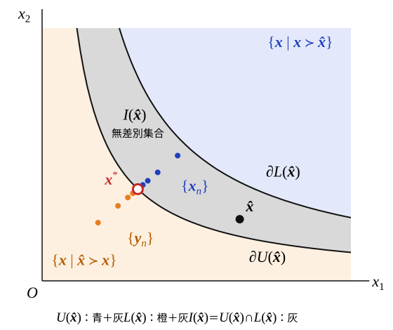

---

# 効用関数

仮定1〜4のもとで，消費者の選好関係 $\succsim$ を表現する方法として，消費集合の中から2つずつの消費計画を選んで比較し，選好される方に大きい実数を割り当て，無差別な消費計画には同じ実数を割り当てることで，消費計画に対して実数値を対応させる写像を考えることができる。

このことは，以下の**Debreu の定理**として知られている。

**定理（効用関数の存在）**：$X \subseteq \mathbb{R}^M$ とする。仮定1〜4のもとで，$X$ 上の連続な実数値関数 $u(\cdot)$ が存在して
$$
u(\boldsymbol{x})\geqq u(\hat{\boldsymbol{x}})\iff\boldsymbol{x}\succsim\hat{\boldsymbol{x}},
\quad\forall\,\boldsymbol{x},\hat{\boldsymbol{x}}\in X
$$
が成り立つ。この関数 $u(\cdot)$ を**効用関数**という。

> **参考**：G. Debreu, "Representation of a Preference Ordering by a Numerical Function", 1954.
> J.-Y. Jaffray, "Existence of a Continuous Utility Function: An Elementary Proof", 1975.

---

効用関数はただ1つだけ存在するわけではない。実際，$u$ が効用関数なら，任意の狭義単調増加関数 $f$ に対して，合成関数 $f \circ u$ も効用関数である：
$$
\boldsymbol{x}\succsim\hat{\boldsymbol{x}}
\iff u(\boldsymbol{x})\geqq u(\hat{\boldsymbol{x}})
\iff f(u(\boldsymbol{x}))\geqq f(u(\hat{\boldsymbol{x}}))
$$

2つの消費計画に対して，効用関数の値の大小の順序付けのみが意味をもち，効用関数の値の差や比率には意味がない。このように，順序のみに意味を持つ効用関数を**序数的効用関数**という。

**参考**：もし $X$ が可算集合なら，仮定1〜3だけで効用関数を構成することができる。実際，$X=\{\boldsymbol{x}_n\}_{n=1}^{\infty}$ を可算集合とするとき，関数 $u(\cdot)$ を次で定義する：
$$
u(\boldsymbol{x})=\sum_{n:\ \boldsymbol{x}_n\prec\boldsymbol{x}}2^{-n}
$$
- $\boldsymbol{x}\succsim\boldsymbol{y}$ のとき，推移律より $\boldsymbol{y}\succsim\boldsymbol{x}_n\Rightarrow\boldsymbol{x}\succsim\boldsymbol{x}_n$ で和をとる集合が包含され $u(\boldsymbol{x})\geqq u(\boldsymbol{y})$。
- $\boldsymbol{x}\succ\boldsymbol{y}$ なら，上記に加え $\boldsymbol{y}=\boldsymbol{x}_m$ が $\boldsymbol{y}$ の和には入らず $u(\boldsymbol{x})\geqq u(\boldsymbol{y})+2^{-m}>u(\boldsymbol{y})$。
- 完備性より，$\boldsymbol{x}\succsim\boldsymbol{y}$ でなければ $\boldsymbol{y}\succ\boldsymbol{x}$ である。よって，$u(\boldsymbol{x})\geqq u(\boldsymbol{y})\iff\boldsymbol{x}\succsim\boldsymbol{y}$。 $\blacksquare$

---

# 【補足】辞書式選好

$X$ が可算集合ではなく $X=\mathbb{R}^M$ のような非可算集合の場合には，**仮定4が本質的に必要**である。

**例（辞書式選好）**：$X=\mathbb{R}^2$ 上の選好関係を次で定義する：
$$
\boldsymbol{x}\succ\boldsymbol{y}
\iff x_1>y_1\ \text{または}\ (x_1=y_1\ \text{かつ}\ x_2>y_2)
$$
この選好関係は仮定1〜3を満たすが，これを表現する効用関数は存在しない。

**証明**：効用関数 $u$ があると仮定する。各 $r\in\mathbb{R}$ に対して，$(r,1)\succ(r,0)$ より $u(r,1)>u(r,0)$ であるから，実数の連続性より有理数 $q(r)\in\big(u(r,0),u(r,1)\big)$ が取れる。$r<r'$ のとき，$(r',0)\succ(r,1)$ より $u(r,1)<u(r',0)$ であるから，区間 $\big(u(r,0),u(r,1)\big)$ と $\big(u(r',0),u(r',1)\big)$ は互いに素で $q(r)\neq q(r')$。すると，$q:\mathbb{R}\to\mathbb{Q}$ は単射となるが，$\mathbb{R}$ は非可算，$\mathbb{Q}$ は可算なので矛盾。 $\blacksquare$

なお，辞書式選好は仮定4を満たさない。実際，
$$
\{\boldsymbol{x}\mid\boldsymbol{x}\succsim(0,0)\}=\{(x_1,x_2)\mid x_1>0\}\cup\{(0,x_2)\mid x_2\geqq 0\}
$$ 
は閉集合でない（点列 $\boldsymbol{x}_n=(1/n,-1)$ の極限を考えればよい）。

---

# 狭義凸選好

本書では，仮定1〜4に加えて，消費者の選好が**狭義凸**であると仮定する。

**仮定5（狭義凸選好）**：任意の異なる2つの消費計画 $\boldsymbol{x},\hat{\boldsymbol{x}} \in X$ が $\boldsymbol{x}\sim\hat{\boldsymbol{x}}$ ならば，$0<\alpha<1$ を満たす任意の実数 $\alpha$ に対して，
$$
\alpha\boldsymbol{x}+(1-\alpha)\hat{\boldsymbol{x}}\succ\boldsymbol{x}
$$

- **狭義凸選好**：両極端の選択肢よりも**平均的な選択肢を好む**ことを表す。
- 任意に実数 $\alpha$ がとれるのは，財が完全に分割可能であることを意味する。

仮定5を効用関数の言葉で表すと，任意の異なる2つの消費計画 $\boldsymbol{x},\hat{\boldsymbol{x}} \in X$ に対して，
$$
u(\boldsymbol{x})=u(\hat{\boldsymbol{x}})
\ \Longrightarrow\ 
u(\alpha\boldsymbol{x}+(1-\alpha)\hat{\boldsymbol{x}})>u(\boldsymbol{x}),
\quad\forall\alpha\in(0,1)
$$
が成り立つ。この性質をもつ関数を**狭義準凹関数**という。効用関数が狭義準凹ならば，消費者の選択行動に予算制約を課したとき最適な消費計画を一意に定めることができるメリットがある。

---

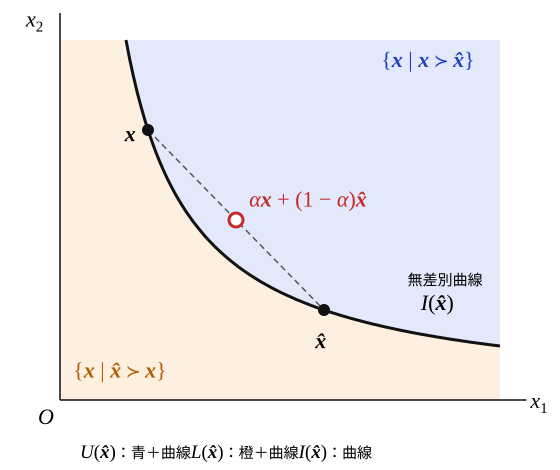

---

# 【補足】凹関数と準凹関数

**定義（凹関数と準凹関数）**：
(1) 関数 $u:X\to\mathbb{R}$ が**凹**であるとは，任意の $\boldsymbol{x},\hat{\boldsymbol{x}}\in X$ と任意の $\alpha\in(0,1)$ に対して，
$$
u(\alpha\boldsymbol{x}+(1-\alpha)\hat{\boldsymbol{x}})\geqq\alpha u(\boldsymbol{x})+(1-\alpha)u(\hat{\boldsymbol{x}})
$$

(2) 関数 $u:X\to\mathbb{R}$ が**準凹**であるとは，任意の $\boldsymbol{x},\hat{\boldsymbol{x}}\in X$ と任意の $\alpha\in(0,1)$ に対して，
$$
u(\alpha\boldsymbol{x}+(1-\alpha)\hat{\boldsymbol{x}})\geqq\min\{u(\boldsymbol{x}),u(\hat{\boldsymbol{x}})\}
$$

- 一般に，凹ならば準凹である。しかし，逆は成り立たない（例：$u(x_1,x_2)=x_1x_2$）。
- **準凹性は単調変換で保たれる**が，凹性は保たれない（例：$u(x_1,x_2)=\sqrt{x_1x_2}$）。

---

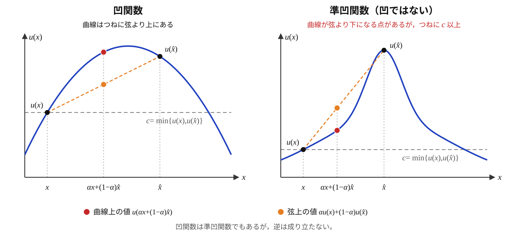

---

# 1.2 期待効用関数

不確実性下の消費者の選好を表すために，まずは将来の不確実な状況を定式化する。将来実現しうる状況（経済変数のベクトル）を**状態**という（経済状態，世の中の状態，自然の状態ともいう）。

- **時点**：現在を**第0期**，将来を**第1期**という。
- **状態** $s\in\{1,\dots,S\}$：将来実現しうる状況を表す。とくに断らない限り $S$ は有限とする。
- **生起確率** $\pi_s$：状態 $s$ が実現する確率。
- 現在は不確実性がない状態，すなわちすでに実現した状態とみなし，添え字 $0$ をつけて区別する。

時間が進み，ある1つの状態が実現すると不確実性は消滅すると考える。

---

物理的特性が同じ財でも，利用可能な状態が異なれば異なる財として区別する。これを**条件付き財**という。このとき，現在の財は $M$ 種類，将来の条件付き財は $S\times M$ 種類である。
消費者 $i$ の現在の財に対する消費計画を
$$
\boldsymbol{x}^i_0=[x^i_{01}\ x^i_{02}\ \cdots\ x^i_{0M}]
$$
で表し，将来の財に対する消費計画は，状態 $s$ に応じて
$$
\boldsymbol{x}^i_s=[x^i_{s1}\ x^i_{s2}\ \cdots\ x^i_{sM}]
$$
で表される。ここで $x^i_{sm}$ は，状態 $s$ が実現したときの消費者 $i$ による第 $m$ 財の消費量である。

---

# 状態と消費計画（図解）

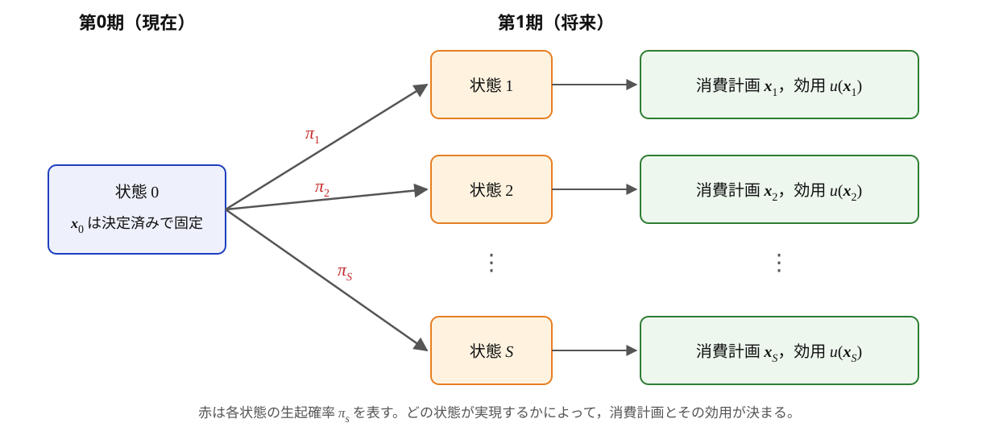

---

本節では，現在の消費計画は $\boldsymbol{x}^i_0$ に決定済みとして固定し，将来の消費計画 $\boldsymbol{x}^i_s$ がもたらす効用 $u^i(\boldsymbol{x}^i_s)$ を分析する。不確実性下で消費計画を順序付けるには，次の2つの要素が必要である。

1. 各状態における消費計画に対する**嗜好の評価**
2. どの状態が実現するかについての**確率の判断**

この2つを分離して分析するには，消費者の選択行動に強い制約が必要であるように思える。

von Neumann and Morgenstern (1944) は，仮定1〜5に加えて，次の仮定6〜8という**弱い制約を課すだけで十分**であることを示した。

---

**仮定6（連続性）**：任意の異なる3つの消費計画 $\boldsymbol{x},\hat{\boldsymbol{x}},\hat{\hat{\boldsymbol{x}}}\in X$ に対して，ある $\alpha\in(0,1)$ がただ1つ存在して，
$$
\boldsymbol{x}\succ\hat{\boldsymbol{x}}\succ\hat{\hat{\boldsymbol{x}}}\ \Longrightarrow \ 
\hat{\boldsymbol{x}}\sim\alpha\boldsymbol{x}+(1-\alpha)\hat{\hat{\boldsymbol{x}}}
$$ 

**仮定7（独立性）**：任意の異なる2つの消費計画 $\boldsymbol{x},\hat{\boldsymbol{x}}\in X$ が $\boldsymbol{x}\succsim\hat{\boldsymbol{x}}$ ならば，第3の消費計画 $\hat{\hat{\boldsymbol{x}}} \in X$ と任意の $\alpha\in(0,1)$ に対して，
$$
\alpha\boldsymbol{x}+(1-\alpha)\hat{\hat{\boldsymbol{x}}}\succsim\alpha\hat{\boldsymbol{x}}+(1-\alpha)\hat{\hat{\boldsymbol{x}}}
$$

**仮定8（単調性）**：任意の異なる2つの消費計画 $\boldsymbol{x},\hat{\boldsymbol{x}}\in X$ が $\boldsymbol{x}\succ\hat{\boldsymbol{x}}$ ならば，任意の $\alpha_1,\alpha_2\in(0,1)$ に対して，
$$
\alpha_1\boldsymbol{x}+(1-\alpha_1)\hat{\boldsymbol{x}}\succsim\alpha_2\boldsymbol{x}+(1-\alpha_2)\hat{\boldsymbol{x}}\iff\alpha_1\geqq\alpha_2
$$

---

- **連続性**：**アルキメデスの公理**ともよばれる。$\alpha$ は，$\boldsymbol{x}$ と $\hat{\hat{\boldsymbol{x}}}$ を凸結合により組み合わせて，両者の中間にある $\hat{\boldsymbol{x}}$ と無差別な消費計画を作るための比率と解釈できる。
- **独立性**：2つの消費計画の選好順序は，共通の第3の消費計画と組み合わせても変わらない。つまり，異なる消費計画の間に補完性や代替性がないことを仮定している。
- **単調性**：選好順序が高い消費計画へのウェイトが大きいほど，合成された消費計画は強く選好される。

> **注意**：教科書の仮定8では $\boldsymbol{x}\succsim\hat{\boldsymbol{x}}$ と書かれている。しかし，$\boldsymbol{x}\sim\hat{\boldsymbol{x}}$ のときは，$\alpha_1<\alpha_2$ であっても2つのくじが無差別となり，$\succsim$ が成り立つ。つまり，「$\Rightarrow$」が成り立たない。そこで，ここでは $\succ$ としている。

> **参考**：標準的な教科書では，単調性は連続性と独立性から導かれる性質として扱われる。なお，その場合，独立性は次のように仮定される：
> $$
> \boldsymbol{x}\succsim\hat{\boldsymbol{x}}\ \Longleftrightarrow\ \alpha\boldsymbol{x}+(1-\alpha)\hat{\hat{\boldsymbol{x}}}\succsim\alpha\hat{\boldsymbol{x}}+(1-\alpha)\hat{\hat{\boldsymbol{x}}}
> $$

---

# 期待効用関数

以上の追加的仮定のもとで，不確実な消費計画に対する消費者 $i$ の選好は，**期待効用関数**
$$
\sum_{s=1}^{S}\pi^i_s\,u^i_s(\boldsymbol{x}^i_s)
$$
によって完全に表現できる（Mas-Colell, Whinston and Green (1995), 第6章）。

- $\boldsymbol{x}^i_s=[x^i_{s1}\ x^i_{s2}\ \cdots\ x^i_{sM}]$ は状態 $s$ における $M$ 種類の財の消費計画である。
- $u^i_s(\cdot)$ は効用関数であり，期待効用関数と区別することを強調したいときには，特に**基礎的効用関数**という。また，異なる状態間で効用関数 $u^i_s(\cdot)$ が加法的であると仮定している。
- $\pi^i_s$ は状態 $s$ が実現する確率であり，Savage (1954) では消費者 $i$ の**主観的確率**とよばれる。各消費者 $i \in \{1,\ldots,I\}$ に対して，次が成り立つ：
$$
\pi^i_s\geqq 0,\quad \forall s \in \{1,\ldots,S\},\qquad \sum_{s=1}^S \pi^i_s=1
$$

---

- von Neumann and Morgenstern (1944) では，すべての消費者で生起確率は共通であると仮定されており，**客観的確率**とよばれる：
$$
\pi^i_s=\pi_s,\quad \forall i \in \{1,\ldots,I\}
$$
- 通常の分析では，基礎的効用関数は**状態から独立**であると仮定される：
$$
u^i_s(\boldsymbol{x}^i_s)=u^i(\boldsymbol{x}^i_s),\quad \forall s \in \{1,\ldots,S\}
$$

いずれの立場でも，期待効用関数は状態の確率 $\pi$ をウェイトとする基礎的効用関数の凸結合で表される。では，以上の仮定1〜8のもとで，期待効用関数がどのように導かれるかを説明する。
<!-- なお，以下の導出はFama and Miller (1972) に従う。 -->

> **参考**：[1] L. J. Savage, "The Foundations of Statistics", 1954.
> [2] F. J. Anscombe and R. J. Aumann, "A Definition of Subjective Probability", 1963.
> [3] E. Karni, "Decision Making under Uncertainty: The Case of State-Dependent Preferences", 1985.
> [4] J. von Neumann and O. Morgenstern, "Theory of Games and Economic Behavior", 1944.

---

将来の状態が2通りの場合（$S=2$）を考える。$\alpha \in (0,1)$ とし，確率 $\alpha$ で $\boldsymbol{x}_1$，確率 $1-\alpha$ で $\boldsymbol{x}_2$ の消費が行われる確率的な消費計画を考える（これは**確率くじ**とみなせる）。このような消費計画を $L(\boldsymbol{x}_1,\boldsymbol{x}_2: \alpha)$ と書く。このとき，仮定6〜8は次のように書ける。

**仮定6'（連続性）**：任意の異なる $\boldsymbol{x},\boldsymbol{x}_1,\boldsymbol{x}_2\in X$ に対して，$\alpha\in(0,1)$ がただ1つ存在して，
$$
\boldsymbol{x}_1\succ\boldsymbol{x}\succ\boldsymbol{x}_2\ \Longrightarrow \ 
\boldsymbol{x}\sim L(\boldsymbol{x}_1,\boldsymbol{x}_2:\alpha)
$$ 

**仮定7'（独立性）**：任意の異なる2つの $\boldsymbol{x}_1,\boldsymbol{x}_1^{\prime}\in X$ が $\boldsymbol{x}_1\succsim\boldsymbol{x}_1^{\prime}$ ならば，任意の $\boldsymbol{x}_2 \in X$ と任意の $\alpha\in(0,1)$ に対して，
$$
L(\boldsymbol{x}_1,\boldsymbol{x}_2:\alpha)\succsim L(\boldsymbol{x}_1^{\prime},\boldsymbol{x}_2:\alpha)
$$

**仮定8'（単調性）**：任意の異なる2つの $\boldsymbol{x}_1,\boldsymbol{x}_2\in X$ が $\boldsymbol{x}_1\succ\boldsymbol{x}_2$ ならば，任意の $\alpha_1,\alpha_2\in(0,1)$ に対して，
$$
L(\boldsymbol{x}_1,\boldsymbol{x}_2:\alpha_1)\succsim L(\boldsymbol{x}_1,\boldsymbol{x}_2:\alpha_2)
\iff\alpha_1\geqq\alpha_2
$$

---

# 期待効用関数の導出

以下は Fama and Miller (1972) を修正したものである。
実現可能な消費計画集合 $X$ において，最も選好される消費計画を $\boldsymbol{x}_a$，最も選好されない消費計画を $\boldsymbol{x}_b$ とする：
$$
\boldsymbol{x}_a\succsim\boldsymbol{x}\succsim\boldsymbol{x}_b,
\qquad\forall\boldsymbol{x}\in X
$$
**仮定6'（連続性）** より，任意の $\boldsymbol{x} \in X$ に対して，
$$
\boldsymbol{x}\sim L(\boldsymbol{x}_a,\boldsymbol{x}_b:\alpha)
$$
を満たす確率 $\alpha \in (0,1)$ がただ1つ存在する。これを $\alpha=\alpha(\boldsymbol{x})$ と書く。これより，任意の $\boldsymbol{x}_1,\boldsymbol{x}_2\in X$ に対して，
$$
\boldsymbol{x}_1\sim L(\boldsymbol{x}_a,\boldsymbol{x}_b:\alpha(\boldsymbol{x}_1)),\qquad
\boldsymbol{x}_2\sim L(\boldsymbol{x}_a,\boldsymbol{x}_b:\alpha(\boldsymbol{x}_2))
$$

> $\alpha(\boldsymbol{x})$ は，$\boldsymbol{x}$ を確実に得ることと，確率 $\alpha$ で最良，確率 $1-\alpha$ で最悪となるくじを無差別にする確率である。また，$\alpha(\boldsymbol{x}_a)=1$，$\alpha(\boldsymbol{x}_b)=0$ と定める。

---

**仮定8'（単調性）** と**仮定2（推移性）** より，
$$
\alpha(\boldsymbol{x}_1)\geqq\alpha(\boldsymbol{x}_2)\iff L(\boldsymbol{x}_a,\boldsymbol{x}_b:\alpha(\boldsymbol{x}_1))\succsim L(\boldsymbol{x}_a,\boldsymbol{x}_b:\alpha(\boldsymbol{x}_2))\iff\boldsymbol{x}_1\succsim\boldsymbol{x}_2
$$
したがって，$\alpha(\cdot)$ は確実な消費計画の選好順序を保存する関数，すなわち**効用関数**である。

あとは，確率くじの順序付けが $\alpha(\cdot)$ の期待値で行えることを示せばよい。ここで，確率くじ $L=L(\boldsymbol{x}_1,\boldsymbol{x}_2:\alpha^*)$ を考える。$\boldsymbol{x}_a\succ L\succ\boldsymbol{x}_b$ とすると，**仮定6'（連続性）** より
$$
L(\boldsymbol{x}_1,\boldsymbol{x}_2:\alpha^*)\sim L(\boldsymbol{x}_a,\boldsymbol{x}_b:\alpha(L))
$$
を満たす $\alpha(L)=\alpha(L(\boldsymbol{x}_1,\boldsymbol{x}_2:\alpha^*))$ がただ1つ存在する。また，$\boldsymbol{x}_1\sim L(\boldsymbol{x}_a,\boldsymbol{x}_b:\alpha(\boldsymbol{x}_1))$ なので，**仮定7'（独立性）** より，
$$
L(\boldsymbol{x}_1,\boldsymbol{x}_2:\alpha^*)
\sim L\big(L(\boldsymbol{x}_a,\boldsymbol{x}_b:\alpha(\boldsymbol{x}_1)),\ \boldsymbol{x}_2:\alpha^*\big)
\sim L\big(L(\boldsymbol{x}_a,\boldsymbol{x}_b:\alpha(\boldsymbol{x}_1)),\ L(\boldsymbol{x}_a,\boldsymbol{x}_b:\alpha(\boldsymbol{x}_2)):\alpha^*\big)
$$
**仮定2（推移性）** より，これら3つのくじはすべて無差別であるから，
$$
L(\boldsymbol{x}_1,\boldsymbol{x}_2:\alpha^*)
\sim L\big(L(\boldsymbol{x}_a,\boldsymbol{x}_b:\alpha(\boldsymbol{x}_1)),\ L(\boldsymbol{x}_a,\boldsymbol{x}_b:\alpha(\boldsymbol{x}_2)):\alpha^*\big)
$$

---

$\triangleright$ $L(\boldsymbol{x}_1,\boldsymbol{x}_2:\alpha^*) \sim L\big(L(\boldsymbol{x}_a,\boldsymbol{x}_b:\alpha(\boldsymbol{x}_1)),\ L(\boldsymbol{x}_a,\boldsymbol{x}_b:\alpha(\boldsymbol{x}_2)):\alpha^*\big)$

右辺は，くじを賞品とするくじ（**複合くじ**）を表している。例えば，最終的に $\boldsymbol{x}_a$ が得られる確率は，
$$
\alpha^*\cdot\alpha(\boldsymbol{x}_1)+(1-\alpha^*)\cdot\alpha(\boldsymbol{x}_2)
$$
である。消費者が**最終結果とその最終的な確率のみ**に関心をもつならば，
$$
L(\boldsymbol{x}_1,\boldsymbol{x}_2:\alpha^*)
\sim L\big(\boldsymbol{x}_a,\boldsymbol{x}_b:\alpha^*\alpha(\boldsymbol{x}_1)+(1-\alpha^*)\alpha(\boldsymbol{x}_2)\big)
$$
が成り立つ。ところで，上記の議論から
$$
L(\boldsymbol{x}_1,\boldsymbol{x}_2:\alpha^*)\sim L(\boldsymbol{x}_a,\boldsymbol{x}_b:\alpha(L))
$$
だったので，$\alpha(L)$ の**一意性**より，
$$
\boxed{\ \alpha\big(L(\boldsymbol{x}_1,\boldsymbol{x}_2:\alpha^*)\big)=\alpha^*\alpha(\boldsymbol{x}_1)+(1-\alpha^*)\alpha(\boldsymbol{x}_2)\ }
$$

---

# 複合くじの還元（図解）

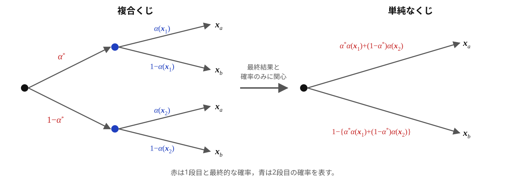

> **補足**：最終的な確率のみに依存するという仮定は**複合くじの還元公理**とよばれ，教科書では暗黙に置かれている。人がくじの「段階」を気にする場合には成り立たない。

---

$\triangleright$ $\alpha\big(L(\boldsymbol{x}_1,\boldsymbol{x}_2:\alpha^*)\big)=\alpha^*\alpha(\boldsymbol{x}_1)+(1-\alpha^*)\alpha(\boldsymbol{x}_2)$

上式は，くじを $\alpha(\cdot)$ で評価した値が各結果の $\alpha(\cdot)$ を確率で加重平均したもの，すなわち $\alpha(\cdot)$ の期待値に等しいことを示している。よって，くじの順序付けは期待効用による順序付けと一致する。 $\blacksquare$

| 公理 | 導出での役割 |
|:--|:--|
| 連続性 | 目盛り $\alpha(\boldsymbol{x})$ の存在と一意性 |
| 単調性 | $\alpha(\cdot)$ が選好順序を保存（効用関数になる） |
| 独立性 | 結果を無差別なくじで置き換えてよい |
| 推移性 | 置き換えた複数のくじがすべて無差別 |

> **補足**：結果が $n$ 個のくじも，「確率 $p_1$ で $\boldsymbol{x}_1$，残りの確率で $\boldsymbol{x}_2,\dots,\boldsymbol{x}_n$ の条件付きくじ」と分解して帰納法を使えば，同様に $\alpha(L)=\sum_k p_k\,\alpha(\boldsymbol{x}_k)$ が示せる。

---

# 【補足】独立性への反例：Allais のパラドックス

仮定7'（独立性）は，実験的に反例が知られている（Allais (1953)）。

**仮定7'（独立性）**：任意の異なる2つの $\boldsymbol{x}_1,\boldsymbol{x}_1^{\prime}\in X$ が $\boldsymbol{x}_1\succsim\boldsymbol{x}_1^{\prime}$ ならば，任意の $\boldsymbol{x}_2 \in X$ と任意の $\alpha\in(0,1)$ に対して，
$$
L(\boldsymbol{x}_1,\boldsymbol{x}_2:\alpha)\succsim L(\boldsymbol{x}_1^{\prime},\boldsymbol{x}_2:\alpha)
$$

確率 $\alpha$ で賞金 $x_1$，確率 $1-\alpha$ で賞金 $x_2$ が得られるくじを $L(x_1,x_2:\alpha)$ とし，次の5つのくじを考える。
$$
\begin{aligned}
&L_0=L(10\text{万円},0\text{万円}:0),\quad L_1=L(10\text{万円},0\text{万円}:0.1),\quad L_2=L(15\text{万円},0\text{万円}:0.09),\\
&L_3=L(10\text{万円},0\text{万円}:1),\quad L_4=L(15\text{万円},0\text{万円}:0.9)
\end{aligned}
$$
例えば，$L_3$ は確実に10万円が得られ，$L_0$ は確実に何も得られない特殊なくじである。実験では，**$L_2\succ L_1$ かつ $L_3\succ L_4$** という選好を示す人が多いことが知られている。

---

これらのくじを期待効用で評価すると，
$$
\begin{align*}
E[u(L_0)]&=0 \cdot u(10\text{万円})+1 \cdot u(0\text{万円})= u(0\text{万円})\\
E[u(L_3)]&=1 \cdot u(10\text{万円})+0 \cdot u(0\text{万円})= u(10\text{万円})\\
E[u(L_1)]&=0.1 \cdot u(10\text{万円})+0.9 \cdot u(0\text{万円})=0.1 \cdot E[u(L_3)]+0.9 \cdot E[u(L_0)]
\end{align*}
$$
より $L_1\sim L(L_3,L_0:0.1)$ である。同様に，
$$
\begin{align*}
E[u(L_4)]&=0.9 \cdot u(15\text{万円})+0.1 \cdot u(0\text{万円})\\
E[u(L_2)]&=0.09 \cdot u(15\text{万円})+0.91 \cdot u(0\text{万円})\\
&=0.1(0.9 \cdot u(15\text{万円})+0.1 \cdot u(0\text{万円}))+0.9 \cdot u(0\text{万円})\\
&=0.1 \cdot E[u(L_4)]+0.9 \cdot E[u(L_0)]
\end{align*}
$$
より $L_2\sim L(L_4,L_0:0.1)$ である。したがって，もし $L_3\succ L_4$ ならば，**独立性**より
$$
L(L_3,L_0:0.1)\succ L(L_4,L_0:0.1)
$$
すなわち $L_1\succ L_2$ が成り立つはずである。これは，実験結果の $L_2\succ L_1$ と**矛盾**する。 $\blacksquare$

---

Allais の反例の主張を言い換えると，多くの人が示す2つの選好はどんな効用関数 $u$ を選んでも期待効用では同時に説明できないことを意味する。ここで，効用関数は $u(0)=0$ と基準化しても一般性を失わない。以下，単位は万円とする。

- $L_3\succ L_4$：$u(10)>0.9\,u(15)$
- $L_2\succ L_1$：$0.09\,u(15)>0.1\,u(10)$，すなわち $0.9\,u(15)>u(10)$

この2つの不等式を同時に満たす関数 $u$ は存在しない。

- **$L_3$ と $L_4$ の比較**：確実に10万円が得られることは非常に魅力的である（**確実性効果**）。
- **$L_1$ と $L_2$ の比較**：当たる確率はどちらも低く，0.10 と 0.09 の差は小さく感じるので，賞金が大きいほうを選ぶ。
<!-- - **期待効用との関係**：期待効用は確率について線形なので，確率を10分の1に縮めても選好は逆転しない。 -->

> **参考**：このような反例は，**プロスペクト理論**（Kahneman–Tversky）など非期待効用理論の動機となった。ただし，本書は期待効用を前提に進む。

---

**命題**：$\alpha(\cdot)$ がある消費者の期待効用関数ならば，その**正1次変換**
$$
U(\cdot)=\gamma_1+\gamma_2\,\alpha(\cdot),\qquad\gamma_2>0
$$
もまた期待効用関数である。また，この変換により，2つのくじの順序付けは保存される。

**証明**：期待効用関数の性質より
$$
\alpha(L(\boldsymbol{x}_1,\boldsymbol{x}_2:\alpha_1))=\alpha_1\alpha(\boldsymbol{x}_1)+(1-\alpha_1)\alpha(\boldsymbol{x}_2)
$$
なので，$\gamma_1=\alpha_1\gamma_1+(1-\alpha_1)\gamma_1$ に注意すると，
$$
\begin{aligned}
U(L(\boldsymbol{x}_1,\boldsymbol{x}_2:\alpha_1))&=\gamma_1+\gamma_2\{\alpha_1\alpha(\boldsymbol{x}_1)+(1-\alpha_1)\alpha(\boldsymbol{x}_2)\}\\
&=\alpha_1\{\gamma_1+\gamma_2\alpha(\boldsymbol{x}_1)\}+(1-\alpha_1)\{\gamma_1+\gamma_2\alpha(\boldsymbol{x}_2)\}\\
&=\alpha_1U(\boldsymbol{x}_1)+(1-\alpha_1)U(\boldsymbol{x}_2)
\end{aligned}
$$
よって，$U$ は期待効用関数の性質を満たす。

---

次に，2つのくじの順序付けが正1次変換によって保存されることを確かめる。もう1つのくじ $L(\boldsymbol{y}_1,\boldsymbol{y}_2:\alpha_2)$ に対して，期待効用関数の性質より
$$
\alpha(L(\boldsymbol{y}_1,\boldsymbol{y}_2:\alpha_2))=\alpha_2\alpha(\boldsymbol{y}_1)+(1-\alpha_2)\alpha(\boldsymbol{y}_2)
$$
である。関数 $U$ で2つのくじを評価すると，
$$
U(L(\boldsymbol{x}_1,\boldsymbol{x}_2:\alpha_1))=\gamma_1+\gamma_2\{\alpha_1\alpha(\boldsymbol{x}_1)+(1-\alpha_1)\alpha(\boldsymbol{x}_2)\}
$$
$$
U(L(\boldsymbol{y}_1,\boldsymbol{y}_2:\alpha_2))=\gamma_1+\gamma_2\{\alpha_2\alpha(\boldsymbol{y}_1)+(1-\alpha_2)\alpha(\boldsymbol{y}_2)\}
$$
$\gamma_2>0$ なので，
$$
\alpha(L(\boldsymbol{x}_1,\boldsymbol{x}_2:\alpha_1))\geqq\alpha(L(\boldsymbol{y}_1,\boldsymbol{y}_2:\alpha_2))\iff U(L(\boldsymbol{x}_1,\boldsymbol{x}_2:\alpha_1))\geqq U(L(\boldsymbol{y}_1,\boldsymbol{y}_2:\alpha_2))
$$
であり，関数 $U$ により順序付けは保存される。 $\blacksquare$

---

# 【補足】効用関数の性質を保存する単調変換は正1次変換のみ

ある効用関数 $u$ が期待効用関数であるとき，任意の単調変換 $v=f(u)$ が期待効用関数であるためには，$f$ は正1次変換でなければならないことを示す。

**命題**：$u$ と $v$ がともに同じ選好を表す期待効用関数ならば，ある $\gamma_1 \in \mathbb{R}$ と $\gamma_2>0$ が存在して，$v=\gamma_1+\gamma_2u$ である。

**証明**：$\boldsymbol{x}_a,\boldsymbol{x}_b$ を最良・最悪の消費計画とし，$\boldsymbol{x}_a\succ\boldsymbol{x}_b$ とする（無差別なら自明）。$u,v$ はともにくじを期待値で評価するので，$u_a=u(\boldsymbol{x}_a)$ などと書くと，
$$
\begin{align*}
u(\boldsymbol{x})&=\alpha(\boldsymbol{x}) \cdot u_a + (1-\alpha(\boldsymbol{x})) \cdot u_b = u_b+(u_a-u_b)\,\alpha(\boldsymbol{x}),\\
v(\boldsymbol{x})&=\alpha(\boldsymbol{x}) \cdot v_a + (1-\alpha(\boldsymbol{x})) \cdot v_b = v_b+(v_a-v_b)\,\alpha(\boldsymbol{x})
\end{align*}
$$
$u_a>u_b$ なので，第1式から $\alpha(\boldsymbol{x})$ を求め，第2式に代入すると，
$$
v(\boldsymbol{x})=\underbrace{v_b-\gamma_2u_b}_{:=\gamma_1}+\underbrace{\frac{v_a-v_b}{u_a-u_b}}_{:=\gamma_2>0}\,u(\boldsymbol{x})\qquad\blacksquare
$$

---

期待効用関数は正1次変換までは一意に定まるが，関数形そのものが一意に定まるわけではない。特に，原点が1つに定まらないので，期待効用の**絶対水準**には意味がなく，異なる消費者間で期待効用を比較することはできない。

しかし，正1次変換で**効用の差の順序**は保存されるので，期待効用の差の大小を比較することはできる：
$$
u(\boldsymbol{x}_1)-u(\boldsymbol{x}_2)\geqq u(\boldsymbol{x}_3)-u(\boldsymbol{x}_4)\iff U(\boldsymbol{x}_1)-U(\boldsymbol{x}_2)\geqq U(\boldsymbol{x}_3)-U(\boldsymbol{x}_4)
$$

効用の数値の加減乗除が実質的な意味をもつ効用関数を**基数的効用関数**という。期待効用関数は，限定された意味で基数的な性質を持つ。

| | 許される変換 | 意味をもつもの |
|:--|:--|:--|
| 序数的効用 | 任意の狭義増加変換 | 大小のみ |
| 期待効用 | 正1次変換のみ | 大小と差の大小 |

---

<!-- # 例1.1：修正セントペテルスブルグの逆説 -->

以上の設定では，期待効用関数が有限であることを仮定している。しかし，状態の数や消費計画が有限でない場合には，期待効用が無限大となるくじを作ることができる。

**例1.1（修正セントペテルスブルグの逆説）**：偏りのない硬貨を表が出るまで投げ続け，$n$ 回目に初めて表が出たら $2^n$ 円を支払うくじを考える。$n$ 回目に初めて表が出る確率は $p(n)=1/2^n$ より，くじがもたらす収益の期待値は
$$
E[2^{\tilde n}]=\sum_{n=1}^{\infty}2^n\,p(n)=\sum_{n=1}^{\infty}2^n\Big(\frac{1}{2^n}\Big)=\sum_{n=1}^{\infty}1=+\infty\ (\text{円})
$$
このくじの期待値は無限大だが，現実には誰も巨額を払ってこのくじを買おうとはしない。実際，基礎的効用関数が $u(x)=\ln x$ ならば，
$$
E[u(2^{\tilde n})]=\sum_{n=1}^{\infty}(\ln2^n)\Big(\frac{1}{2^n}\Big)=(\ln2)\sum_{n=1}^{\infty}\frac{n}{2^n}=2\ln2=\ln4
$$
となり，このくじの効用は確実に4円がもたらす効用に等しい。

---

期待効用が有限になったのは，効用関数 $u(x)=\ln x$ の凹性による。しかし，効用関数が上に有界でない限り，期待効用が無限大のくじを作れる。例えば，$n$ 回目に初めて表が出たときに $\exp(2^n)$ 円を支払うくじを考えると，対数効用でも
$$
E[u(\exp(2^{\tilde n}))]=\sum_{n=1}^\infty(\ln\exp(2^n))\Big(\frac1{2^n}\Big)=\sum_{n=1}^\infty2^n\Big(\frac1{2^n}\Big)=\sum_{n=1}^\infty1=+\infty
$$
同様に，$\exp(3^n)$ 円，$\exp(4^n)$ 円支払うくじも期待効用は無限大となり，期待効用による順序付けができなくなる。これを**修正セントペテルスブルグの逆説**という。

この問題は，次のいずれかの方法で回避できる。

- **効用関数の制限**：狭義凹の効用関数と，期待値が有限の消費計画を仮定する。
- **消費計画の制限**：消費計画を有界に制限する（状態数 $S$ を有限にすれば有界になる）。

> **補足**：$u$ が上に有界なら，$E[u]\leqq\sup u<\infty$ なので，この種の逆説は生じない。

---

<!-- # 【補足】$\sum n/2^n=2$ の計算と確率変数の確認

$A=\sum_{n=1}^\infty n/2^n$ とおくと，
$$
A-\frac12A=\sum_{n=1}^\infty\frac{n}{2^n}-\sum_{n=1}^\infty\frac{n}{2^{n+1}}=\frac12+\sum_{n=2}^{\infty}\frac{n-(n-1)}{2^n}=\sum_{n=1}^\infty\frac1{2^n}=1
$$
より，$A=2$ である。

--- -->

# 1.3 危険回避と危険プレミアム

本節では，不確実性の下での消費者の選択行動について，危険回避の概念を導入する。前節までは，個別の財それぞれに対して効用関数を定義していたが，資産市場の分析では，個別の財ではなく**単一の合成された消費財の貨幣価値**に対して効用関数を定義すると見通しがよい。

- $M$ 種類の財の消費計画が，ベクトル $\boldsymbol{x}_0=[x_{01}\cdots x_{0M}]$ で表されるとする。この中から1つを**基準財**とし，その1単位の価格を1円とする。
- 他の財の価格は，市場で基準財と交換する際の交換比率で与えられる。現実には，価値尺度・交換手段・価値保蔵手段の機能をもつ財が**貨幣**として流通する（本書では現金）。
- 各財の1単位あたりの価格がベクトル $\boldsymbol{p}_0=[p_{01}\cdots p_{0M}]$ で与えられるとき，$M$ 種類の財から構成される合成された財 $\boldsymbol{x}_0$ の現在の貨幣価値は
$$
c_0=\sum_{m=1}^M p_{0m}x_{0m}
$$

---

- 状態 $s \in \{1,\ldots,S\}$ が実現したときの条件付き財の1単位の価格が $\boldsymbol{p}_s=[p_{s1}\cdots p_{sM}]$ で与えられるとき，$\boldsymbol{x}_s$ で表される財の将来の貨幣価値は
$$
c_s=\sum_{m=1}^M p_{sm}x_{sm}
$$
なお，効用関数 $u(c_0)$，$u(c_s)$ は，与えられた価格のもとで，消費者が効用を最大にするように各財の消費量を最適に決めたときの効用を表す。

将来の消費計画の貨幣価値をベクトル $\boldsymbol{c}=[c_1\ \cdots\ c_S]$ で表す。

- **安全な消費計画**：どの状態でも同じ定数である消費計画で，$c_s=c^*\ (\forall s \in \{1,\ldots,S\})$。
- **危険な消費計画**：安全でない消費計画で，少なくとも2つの要素が異なる。

安全という用語は，消費計画の不確実性がないことを意味する。危険という用語は，消費計画の不確実性があることを意味する。

---

状態 $s \in \{1,\ldots,S\}$ が実現する確率を $\boldsymbol{\pi}=[\pi_1\cdots\pi_S]$ とし，危険な消費計画を確率変数 $\tilde c$ で表すと，危険な消費計画の期待値は
$$
E[\tilde c]=\sum_{s=1}^S\pi_sc_s,\qquad E[u(\tilde c)]=\sum_{s=1}^S\pi_su(c_s)
$$

**定義1.1（危険選好）**：消費者の基礎的効用関数を $u(\cdot)$ として
$$
\begin{aligned}
u(E[\tilde c])>E[u(\tilde c)]&\iff\text{消費者は}\textbf{危険回避的}\\
u(E[\tilde c])=E[u(\tilde c)]&\iff\text{消費者は}\textbf{危険中立的}\\
u(E[\tilde c])<E[u(\tilde c)]&\iff\text{消費者は}\textbf{危険愛好的}
\end{aligned}
$$

基礎的効用関数の形状と危険に対する選好の関係は，Jensen の不等式により次のように表される。

---

**命題1.1（Jensen の不等式）**：$u(\cdot)$ は2回連続微分可能な基礎的効用関数で，$\tilde c$ を危険な消費計画とするとき，
$$
\begin{aligned}
u(E[\tilde c])>E[u(\tilde c)]&\iff u(\cdot)\ \text{は凹関数}\\
u(E[\tilde c])=E[u(\tilde c)]&\iff u(\cdot)\ \text{は線形関数}\\
u(E[\tilde c])<E[u(\tilde c)]&\iff u(\cdot)\ \text{は凸関数}
\end{aligned}
$$

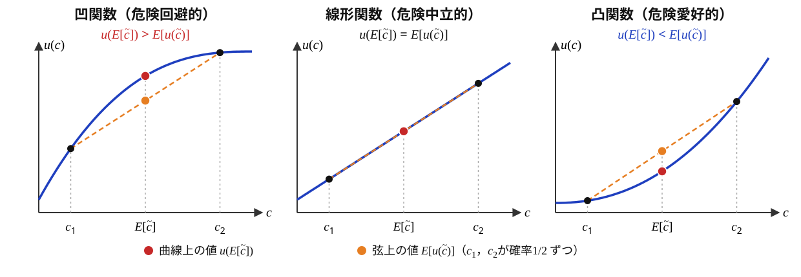

---

**証明**：左向きの主張を示す。$\mu:=E[\tilde c]$ とおき，$\mu$ のまわりで $u(\tilde c)$ をテイラー展開すると，
$$
u(\tilde c)=u(\mu)+(\tilde c-\mu)u'(\mu)+\tfrac12(\tilde c-\mu)^2u''\big(\mu+\theta(\tilde c-\mu)\big),\quad0<\theta<1
$$
$u(\mu)$，$u'(\mu)$ は確定値であることに注意して両辺の期待値をとると，
$$
\begin{aligned}
E[u(\tilde c)]&=u(\mu)+\underbrace{E[\tilde c-\mu]}_{=0}u'(\mu)+\tfrac12E\big[(\tilde c-\mu)^2u''(\mu+\theta(\tilde c-\mu))\big]\\
&=u(\mu)+\tfrac12E\big[\underbrace{(\tilde c-\mu)^2}_{\geqq0}\ u''(\mu+\theta(\tilde c-\mu))\big]
\end{aligned}
$$
もし $u$ が凹関数なら，$u''(\cdot)<0$ である。$\tilde c$ は危険な消費計画なので，$(\tilde c-\mu)^2>0$ となる状態が正の確率で存在する。よって，
$$
E\big[(\tilde c-\mu)^2\ u''(\mu+\theta(\tilde c-\mu))\big]<0
$$
であるから，$E[u(\tilde c)]<u(\mu)=u(E[\tilde c])$ となる。もし $u$ が凸関数なら，$u''(\cdot)>0$，線形関数なら，$u''(\cdot)=0$ となる。

---

次に，逆向きの主張を示す。すなわち，すべての危険な消費計画 $\tilde c$ に対して，$u(E[\tilde c])>E[u(\tilde c)]$ を仮定して，$u$ が凹関数であることを示す。

任意の異なる2つの消費計画 $c_1,c_2$ と $\alpha\in(0,1)$ に対して，確率 $\alpha$ で $c_1$，$1-\alpha$ で $c_2$ となるくじを考える。すると，仮定より
$$
u(\alpha c_1+(1-\alpha)c_2)>\alpha u(c_1)+(1-\alpha)u(c_2)
$$
であるが，これは凹関数の定義そのものである。 $\blacksquare$

---

# 限界効用逓減と現実の行動

すべての消費者は，消費が大きいほど効用が高い（非飽和）から，$u'(\cdot)>0$ であり，限界効用は正である。また，危険回避的な消費者は $u''(\cdot)<0$ であるから，消費水準の増加とともに限界効用は減少する**限界効用逓減**の性質が現れる。

**Friedman and Savage (1948)**：同一人物が保険に加入する一方で宝くじも買う，という一見矛盾した行動を，富の水準によって危険への態度が変わる効用関数で説明した。消費水準が $c_a$ 以下と $c_b$ 以上の階層では危険回避的な行動が，中間階層では危険愛好的な行動が予想される。

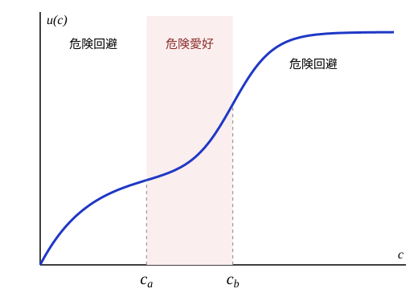

---

# 確実性等価と危険プレミアム

本書では以下，**消費者は危険回避的**と仮定して，その程度の度合いを測る方法を考える。

危険回避的な基礎的効用関数 $u(\cdot)$ と危険な消費計画 $\tilde c$ に対して，
$$
E[u(\tilde c)]=u(c^\circ)
$$
を満たす実数 $c^\circ$ を，$\tilde c$ の**確実性等価**という。これは，危険な消費計画と同じ期待効用をもたらす安全な消費計画 $\boldsymbol{c}^{\circ}=[c^\circ\cdots c^\circ]$ である。また，
$$
\Pi=E[\tilde c]-c^\circ
$$
で定義される $\Pi$ を**危険プレミアム**といい，$c^\circ=E[\tilde c]-\Pi$ を代入すると，
$$
E[u(\tilde c)]=u(E[\tilde c]-\Pi)
$$
これより，消費者が危険な消費計画 $\tilde c$ を選ぶことと，その期待値 $E[\tilde c]$ より $\Pi$ だけ低いが確実な消費計画を受け容れることが**無差別になるような調整額**が危険プレミアムである。

---

# 危険プレミアム（図示）

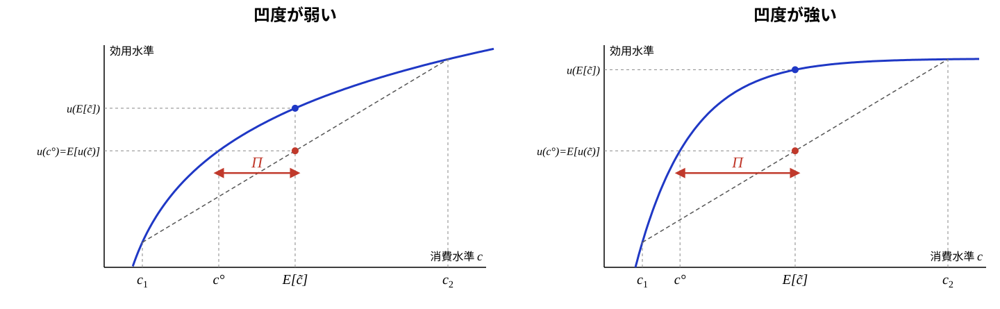

効用関数の**凹度が強い**（危険回避の程度が強い）ほど $\Pi$ は大きい。

---

# 1.4 絶対的危険回避度と相対的危険回避度

Pratt (1964) にしたがい，危険プレミアム $\Pi$ を効用関数の形状から近似し，消費者の危険回避の程度を測る2つの指標を導入する。

- 初期富 $W$ 円をもつ消費者の選好は基礎的効用関数 $u(\cdot)$ で表され，$u(\cdot)$ は狭義準凹の増加関数で2回連続微分可能であるとする。

平均的な収益はゼロだが無料で参加できるギャンブルがあり，消費者が参加するかどうかを選択する状況を考える。ギャンブルの結果得られる利益を $\tilde\varepsilon$ 円とする。$E[\tilde\varepsilon]=0$ であるから，参加した場合の富の水準を $\tilde x$ とすると
$$
\tilde x=W+\tilde\varepsilon,\qquad E[\tilde x]=W
$$
$\tilde x$ の確実性等価は $x^\circ=W-\Pi$ なので，
$$
u(x^\circ)=E[u(\tilde x)]\iff 
u(W-\Pi)=E[u(W+\tilde\varepsilon)]
$$
この式から $\Pi$ を（近似的に）求めることができる。

---

$u(W-\Pi)$ をテイラー展開すると，
$$
u(W-\Pi)=u(W)-u'(W)\Pi+\frac{1}{2}u''(W)\Pi^2-\cdots
$$
また，$E[u(W+\tilde\varepsilon)]$ についても同様にテイラー展開すると，$E[\tilde\varepsilon]=0$ かつ $E[\tilde\varepsilon^2]=\mathrm{Var}[\tilde\varepsilon]$ より，
$$
\begin{aligned}
E[u(W+\tilde\varepsilon)]
&=E\big[u(W)+u'(W)\tilde\varepsilon+\frac{1}{2}u''(W)\tilde\varepsilon^2+\frac{1}{6}u'''(W)\tilde\varepsilon^3+\cdots\big]\\
&=u(W)+\frac{1}{2}u''(W)\mathrm{Var}[\tilde\varepsilon]+\frac{1}{6}u'''(W)E[\tilde\varepsilon^3]+\cdots
\end{aligned}
$$
それぞれの式の第2項までの近似をとると，$u(W-\Pi)=E[u(W+\tilde\varepsilon)]$ から
$$
u(W)-u'(W)\Pi\fallingdotseq u(W)+\frac{u''(W)}{2}\mathrm{Var}[\tilde\varepsilon]
\iff
\boxed{\ \Pi\fallingdotseq-\frac{u''(W)}{u'(W)}\cdot\frac{\mathrm{Var}[\tilde\varepsilon]}{2}\ }
$$

> 左辺は $\Pi$ について1次，右辺は $\tilde\varepsilon$ について2次まで残している。$\Pi$ は $\mathrm{Var}[\tilde\varepsilon]$ の程度の小さい量なので，$\Pi^2$ の項は高次の微小量として落とせる。

---

よって，危険プレミアム $\Pi$ は「**効用関数の情報 $-u''/u'$**」と「**ギャンブルの危険の情報 $\mathrm{Var}[\tilde\varepsilon]/2$**」の積で近似できる。そこで，効用関数の情報を危険選好に対する尺度として定義する。

**定義1.2（Arrow–Pratt の絶対的危険回避度）**：富の水準が $W$ のとき，基礎的効用関数 $u(\cdot)$ に対して，
$$
\mathcal{A}(W):=-\frac{u''(W)}{u'(W)}
$$
を **Arrow–Pratt の絶対的危険回避度**と定義する。

- 非飽和の仮定より $u'>0$，危険回避的な消費者の仮定より $u''<0$ なので，$\mathcal{A}(W)>0$。
- $\mathcal{A}(W)$ は**正1次変換で不変**な尺度である。実際，$u$ と同じ選好の順序付けを行う効用関数 $\bar u=au+b\ (a>0)$ に対して，$\bar u'=au'$，$\bar u''=au''$ より，
$$
-\frac{\bar u''}{\bar u'}=-\frac{u''}{u'}
$$
<!-- - 近似の有効性：$u'''$ が有界で，$\tilde\varepsilon$ の3次以上のモーメントが分散に比べ無視できること（Samuelson (1970) の**コンパクト分布**）。 -->

---

# 保険危険プレミアムと補償危険プレミアム

危険回避的な消費者は，Jensen の不等式より次が成り立つ。
$$
E[u(W+\tilde\varepsilon)]<u(E[W+\tilde\varepsilon])=u(W)
$$
- **左辺** $E[u(W+\tilde\varepsilon)]$：ギャンブルに参加した場合の期待効用を表す
- **右辺** $u(W)$：参加しない場合の効用を表す

よって，危険回避的な消費者は**期待収益ゼロのギャンブルには決して参加しない**。

さらに，危険プレミアム $\Pi$ を用いると，$u(W-\Pi)=E[u(W+\tilde\varepsilon)]$ が成り立つ。これは，危険なギャンブルを回避するためなら**最大 $\Pi$ まで保険料を支払ってよい**と解釈できる。この意味で，$\Pi$ を**保険危険プレミアム**という。

逆に，ギャンブルの不確実性を補填するような正の期待利益が期待できるならば，危険回避的な消費者でもギャンブルに参加してもよいと考えることができる。つまり，ギャンブルの期待利益が $\Pi^*(>0)$ 以上なら，このギャンブルに参加してもよいと考える無差別な水準 $\Pi^*$ が存在する：
$$
E[u(W+\Pi^*+\tilde\varepsilon)]=u(W),\qquad\Pi^*>0
$$

---

この $\Pi^*$ を**補償危険プレミアム**という。左辺の $E[u(W+\Pi^*+\tilde\varepsilon)]$ をテイラー展開すると
$$
\begin{align*}
E[u(W+\Pi^*+\tilde\varepsilon)]
&=E[u(W+\Pi^*)+u'(W+\Pi^*)\tilde\varepsilon+\frac{1}{2}u''(W+\Pi^*)\tilde\varepsilon^2+\cdots]\\
&=u(W+\Pi^*)+\frac{1}{2}u''(W+\Pi^*)E[\tilde\varepsilon^2]+\cdots
\end{align*}
$$
さらに，$u(W+\Pi^*)$ をテイラー展開し，$u$ の3階以上の微分の項と ${\Pi^*}^2$ の項を無視すると
$$
\begin{aligned}
E[u(W+\Pi^*+\tilde\varepsilon)]
&=\{u(W)+u'(W)\Pi^*\}+\frac{1}{2}\{u''(W)+u'''(W)\Pi^*\}E[\tilde\varepsilon^2]+\cdots\\
&\fallingdotseq u(W)+u'(W)\Pi^*+\frac{1}{2}u''(W)E[\tilde\varepsilon^2]
\end{aligned}
$$
したがって，補償危険プレミアムは保険危険プレミアムと同じ形で近似できる：
$$
\Pi^*\fallingdotseq-\frac{u''(W)}{u'(W)}\cdot\frac{\mathrm{Var}[\tilde\varepsilon]}{2}=\mathcal{A}(W)\frac{\mathrm{Var}[\tilde\varepsilon]}{2}
$$
絶対的危険回避度が高い消費者ほど，危険を引き受けさせるには高い危険プレミアムが必要。

---

$\mathrm{Var}[\tilde\varepsilon]>0$ より，富 $W$ が変化したときの危険プレミアムと絶対的危険回避度の関係は
$$
\frac{\partial\Pi}{\partial W}\gtreqless0\iff\frac{\partial\mathcal{A}(W)}{\partial W}\gtreqless0
$$
そこで，$\partial\mathcal{A}(W)/\partial W$ の符号によって効用関数を分類する。

**定義（種々の効用関数）**：基礎的効用関数 $u(\cdot)$ に対して，

- $\partial\mathcal{A}(W)/\partial W>0$ ならば，$u(\cdot)$ は**IARA 型効用関数**という。
- $\partial\mathcal{A}(W)/\partial W=0$ ならば，$u(\cdot)$ は**CARA 型効用関数**という。
- $\partial\mathcal{A}(W)/\partial W<0$ ならば，$u(\cdot)$ は**DARA 型効用関数**という。

- **IARA**（increasing absolute risk aversion）：富が増えるほど危険を避けにくくなる
- **CARA**（constant absolute risk aversion）
- **DARA**（decreasing absolute risk aversion）：富が増えるほど危険を受け容れやすくなる

---

# 相対的危険回避度

一方，危険プレミアムを，富の水準 $W$ ではなく**富に対する比率**で考えることもできる。危険プレミアムは $\Pi=E[\tilde x]-x^\circ=W-x^\circ$ より，$\Pi$ の $W$ に対する比率
$$
\hat\Pi:=\frac{W-x^\circ}{W}
$$
を用いると，確実性等価は $x^\circ=W(1-\hat\Pi)$ である。ギャンブルに参加した場合の富と参加しない場合の富の比率を**粗収益率**とよぶ：
$$
\tilde R:=\frac{W+\tilde\varepsilon}{W}
$$
すると，将来の富の水準は，
$$
W+\tilde\varepsilon=W\tilde R=W+W(\tilde R-1)
$$
確実性等価の定義式 $u(x^\circ)=E[u(W+\tilde\varepsilon)]$ に代入すると，
$$
u(W-W\hat\Pi)=E[u(W+W(\tilde R-1))]
$$

---

$u(W-W\hat\Pi)$ と $E[u(W+W(\tilde R-1))]$ をそれぞれテイラー展開すると，
$$
\begin{align*}
u(W-W\hat\Pi)&=u(W)-u'(W)(W\hat\Pi)+\cdots\\
E[u(W+W(\tilde R-1))]
&=E\big[u(W)+u'(W)\{W(\tilde R-1)\}+\frac{1}{2}u''(W)\{W(\tilde R-1)\}^2+\cdots\big]\\
&=u(W)+\frac{1}{2}u''(W)W^2\mathrm{Var}[\tilde R]+\cdots
\end{align*}
$$
ここで，$\tilde R=1+\tilde\varepsilon/W$ より
$$
E[\tilde R]=E[\tilde\varepsilon]/W=1, \qquad 
E[(\tilde R-1)^2]=\mathrm{Var}[\tilde R]
$$
が成り立つことを用いた。第2項までの近似を用いると，比率表示の危険プレミアムの近似として次が得られる：
$$
-u'(W)(W\hat\Pi)\fallingdotseq\frac{u''(W)}{2}W^2\mathrm{Var}[\tilde R]
\iff
\hat\Pi\fallingdotseq-W\frac{u''(W)}{u'(W)}\cdot\frac{\mathrm{Var}[\tilde R]}{2}
$$

---

**定義1.3（Arrow–Pratt の相対的危険回避度）**：富の水準が $W$ のとき，基礎的効用関数 $u(\cdot)$ に対して，
$$
\mathcal{R}(W):=-W\frac{u''(W)}{u'(W)}
$$
を **Arrow–Pratt の相対的危険回避度**と定義する。

定義より，$\mathcal{R}(W)=W\mathcal{A}(W)$ かつ $\hat\Pi\fallingdotseq\mathcal{R}(W)\mathrm{Var}[\tilde R]/2$ である。また，$u''(W)=du'(W)/dW$ を上式に代入すると
$$
\mathcal{R}(W)=-\Big(\frac{du'(W)}{u'(W)}\Big)\Big/\Big(\frac{dW}{W}\Big)
$$
これより，相対的危険回避度は**限界効用の富に対する弾力性**（富が1\%増えたとき限界効用が何\%減るか）と解釈できる。

---

富の水準が変化したときの比率表示の危険プレミアムと相対的危険回避度との関係は，
$$
\frac{\partial\hat\Pi}{\partial W}\gtreqless0
\iff\frac{\partial\mathcal{R}(W)}{\partial W}\gtreqless0
$$
そこで，$\partial\mathcal{A}(W)/\partial W$ のときと同様に，$\partial\mathcal{R}(W)/\partial W$ の符号によって効用関数を分類する。

**定義（種々の効用関数）**：基礎的効用関数 $u(\cdot)$ に対して，

- $\partial\mathcal{R}(W)/\partial W>0$ ならば，$u(\cdot)$ は**IRRA 型効用関数**という。
- $\partial\mathcal{R}(W)/\partial W=0$ ならば，$u(\cdot)$ は**CRRA 型効用関数**という。
- $\partial\mathcal{R}(W)/\partial W<0$ ならば，$u(\cdot)$ は**DRRA 型効用関数**という。

- **IRRA**（increasing relative risk aversion）
- **CRRA**（constant relative risk aversion）
- **DRRA**（decreasing relative risk aversion）

---

# 【補足】Pratt の定理：危険回避度の比較

$\mathcal{A}$ が「危険回避の程度」の尺度として正当であることは，次の定理で保証される。

**定理（Pratt の定理(1964)）**：2回連続微分可能で狭義増加な基礎的効用関数 $u_1,u_2$ に対して，次は同値となる：
1. すべての富 $W$ に対して，$\mathcal{A}_1(W)\geqq\mathcal{A}_2(W)$ である。
2. ある狭義増加な凹関数 $\phi$ が存在して，$u_1=\phi\circ u_2$ で表せる。
3. すべての富 $W$ と期待値0の任意のリスク $\tilde\varepsilon$ に対して，$\Pi_1(W,\tilde\varepsilon)\geqq\Pi_2(W,\tilde\varepsilon)$ である。

**[1⇒2]**：$\phi=u_1\circ u_2^{-1}$ とおき，$t=u_2(W)$ として微分する。$dW/dt=1/u_2'(W)$ より，
$$
\phi'(t)=\frac{u_1'(W)}{u_2'(W)}>0,\qquad\phi''(t)=\frac{u_1''u_2'-u_1'u_2''}{u_2'^3}=\frac{u_1'(W)}{u_2'(W)^2}\big(\mathcal{A}_2(W)-\mathcal{A}_1(W)\big)\leqq0
$$
よって，$\phi$ は狭義増加な凹関数である。

---

**[2⇒3]**：危険プレミアムの定義と，凹関数 $\phi$ に対する Jensen の不等式より，
$$
\begin{aligned}
u_1(W-\Pi_1)&=E[u_1(W+\tilde\varepsilon)]=E[\phi(u_2(W+\tilde\varepsilon))]\\
&\leqq\phi(E[u_2(W+\tilde\varepsilon)])=\phi(u_2(W-\Pi_2))=u_1(W-\Pi_2)
\end{aligned}
$$
$u_1$ は増加関数なので，$W-\Pi_1\leqq W-\Pi_2$，すなわち $\Pi_1\geqq\Pi_2$ である。

**[3⇒1]**：$\tilde\varepsilon$ を $k\tilde\varepsilon$（$k>0$）に置き換える。前述の近似 $\Pi\fallingdotseq\mathcal{A}(W)\mathrm{Var}[\tilde\varepsilon]/2$ は $k\to0$ のとき誤差が $o(k^2)$ となる意味で成り立つので，
$$
\lim_{k\to0}\frac{\Pi_i(W,k\tilde\varepsilon)}{k^2}=\frac{\mathrm{Var}[\tilde\varepsilon]}{2}\,\mathcal{A}_i(W),\qquad i=1,2
$$
3 より，すべての $k$ に対して $\Pi_1(W,k\tilde\varepsilon)/k^2\geqq\Pi_2(W,k\tilde\varepsilon)/k^2$ である。極限をとると，$\mathrm{Var}[\tilde\varepsilon]>0$ より $\mathcal{A}_1(W)\geqq\mathcal{A}_2(W)$ となる。 $\blacksquare$

> **参考**：J. W. Pratt, "Risk Aversion in the Small and in the Large", 1964.

---

# 1.5 危険回避度と危険資産への投資

本節の目的は，前節で定義した危険回避度の概念を用いて，危険回避的な消費者の投資行動を検討することである。そのために，まず本節以降の分析で前提とされる**経済の枠組み**を説明する。

- 第0期（現在）と第1期（将来）の2期間を考え，各期は一定の長さで区切られている。
- 各期の期初に市場が開き，その日にかぎって財や金融資産を売買できると仮定する。
- 将来の経済の状態は $S$ 通りあり，$s\in\{1,\dots,S\}$ で表す。
- どの状態が実現するかは第1期の期初までわからないが，生起しうる状態がどのような状況であるかについては，消費者全員が合意しているとする。
- 経済を構成する主体は，$I$ 人の消費者と $J$ 社の企業である。
- 企業は，第0期の期初に生産要素を投入し，第1期の期初にさまざまな財を生産し販売する。生産要素を購入する資金は，第0期の期初に株式を発行し，消費者に購入してもらうことで調達する。株式の発行・売買が行われる市場が証券市場である。

---

- 調達した資金を投資して第1期の期初に収益をあげ，そのすべてを株主である消費者へ，株式の保有比率に応じて配当として分配する。第1期の期初には事業収益とともに保有するすべての実物資産を売却し，手に入れた現金のすべてを株主へ配当として支払って清算する。
- 企業が異なれば，期末に実現する状態に応じて，異なる配当支払いのパターンを生むと考えられる。そこで，どの企業の配当パターンも，他の企業の配当パターンを組み合わせて複製することはできないと仮定する。
- 株式を将来の現金収入をもたらす金融資産として保有する消費者からみれば，この仮定は，資産市場に1次独立な収益をもたらす $J$ 種類の株式が存在し，売買可能であることにほかならない。
- 第0期の期初に外生的に与えられる富を**初期賦存量**という。遺産などで与えられた財や金融資産，企業で労働者として働く場合に売り渡す労働力が含まれる。初期賦存量の市場価値の合計を**初期富**という。

---

- 市場は期初にしか開かないので，期初に初期賦存量を売却して得た資金で消費財を購入し，第0期の残りの日々に消費する。初期富から財の購入費用を差し引いた残余が**貯蓄**であり，これも期初に金融資産へ投資される。消費が初期富より大きいときは貯蓄が負になり，不足資金を金融市場で借り入れる。
- 期初に金融資産からの配当と第1期の賦存量のすべてを売却し，それで得た財を第1期の残りの日々に消費する。
- 消費者は2期間にわたる視野のもとで各財への消費支出を計画し，各期の効用は，その期に消費する財の数量に対して定義される。このように，各消費者が第0期と第1期に2回最適に消費を行う分析モデルを**2期間モデル**とよぶ。
- 本節の主たる関心は，不確実性下で消費者の貯蓄がどのように金融資産へ投資されるのか，すなわち効用関数で表される危険への選好と投資行動の関係を明らかにすることである。そこで，第0期の最適消費は決定済みで，その残余である投資用資金が初期富 $W^i_0$ として外生的に与えられるとする。

---

- 消費者は，金融資産投資が生む配当がもたらす第1期の消費の期待効用のみを最大化する。
- 異なる消費者を区別する必要がないので，以下では添字 $i$ を省略する。

消費者が第0期の期初に企業 $j$ の株式を購入し，第1期の期初に状態 $s$ が実現して収益を得る。
- **粗収益**：この収益額そのもの。
- **粗収益率**：粗収益を購入費用で割ったもの，すなわちグロス表示の投資収益率。
- **純収益**：粗収益から購入費用を差し引いたもの，すなわち正味収益。
- **純収益率**：購入費用1円あたりの純収益，すなわちネット表示の投資収益率。

本書では主に粗収益率を用い，状態 $s$ における資産 $j$ の粗収益率を $R_{sj}$，純収益率を $r_{sj}$ と書く。このとき，
$$
r_{sj}=R_{sj}-1,\quad\forall s\in\{1,\dots,S\}
$$
であるから，粗収益率で表したすべての結果は，純収益率に容易に読みかえられる。

---

また，第0期の期初にはどの状態が実現するかわからないので，消費者は資産 $j$ の収益率を確率変数として認識する。これを明らかにするときは $\tilde R_j$ と書く。

第0期の期初の企業 $j$ の価値を $v_j$ 円，状態 $s$ における第1期の期初の価値を $Z_{sj}$ 円とする。企業は第1期の期初に清算され，$Z_{sj}$ 円はすべて配当として株主に支払われるので
$$
R_{sj}=Z_{sj}/v_j,\quad\forall s\in\{1,\dots,S\}
$$

企業の有限責任を仮定すれば，$Z_{sj}$，$v_j$ は非負なので，$R_{sj}$ も非負である。$J$ 種類の資産の粗収益率は，状態別に $S\times J$ の行列 $\boldsymbol{R}$ で表すと便利である。
$$
\boldsymbol{R}=\begin{bmatrix}R_{11}&R_{12}&\cdots&R_{1J}\\\vdots&\vdots&&\vdots\\R_{S1}&R_{S2}&\cdots&R_{SJ}\end{bmatrix}
$$

---

第1期の収益がすべての状態で同一の定数である資産は，その収益を第0期の期初に確実に予測できる。このような確実な収益をもたらす資産を**安全資産**あるいは**無危険資産**といい，$j=0$ として表す。安全資産の粗収益率は各状態で等しいので，添字 $f$ を付けて
$$
R_f=R_{s0},\quad\forall s\in\{1,\dots,S\}
$$
と表し，これを**安全利子率**あるいは**無危険利子率**という。

安全資産は，現実には国債のように国家の信用で貸借が行われるときに発行されるが，本書では消費者間で貸借が行われるときに発行される資産を想定し，その貸借を合計したネットの供給量はゼロとする。行列 $\boldsymbol{R}$ で表される $j\geqq1$ の資産は，少なくとも2つの状態で異なる収益をもたらす。このような資産は，安全資産に対して**危険資産**と総称される。

---

# 1つの危険資産への投資問題

消費者が危険回避的であるとき，初期富 $W_0$ を安全資産へどのような割合で投資するのかを，危険回避度を通じて考える。効用関数は $u'(\cdot)>0$，$u''(\cdot)<0$ を満たすとし，危険資産が1種類しかない場合を考える。

初期富 $W_0$ のうち，危険資産へ $a$ 円，安全資産へ $W_0-a$ 円を投資すると，第1期期初の富は
$$
\tilde W_1=a\tilde R+(W_0-a)R_f=a(\tilde R-R_f)+W_0R_f
$$
であり，これが第1期の消費にあてられる。消費者は期待効用 $E[u(\tilde W_1)]$ を最大化するように配分するので，そのための必要十分条件は，
$$
\begin{align*}
\frac{\partial E[u(\tilde W_1)]}{\partial a}=0
&\iff E[u'(\tilde W_1)(\tilde R-R_f)]=0 \\
&\iff E\big[u'\big(a(\tilde R-R_f)+W_0R_f\big)(\tilde R-R_f)\big]=0
\end{align*}
$$
これを満たす最適投資額を $a=a^*$ と書く。

> **注意**：$a<0$（空売り）や $a>W_0$（借入れによる投資）も許されている。

---

**$a=0$ での評価**
$$
f(0)=E[u'(W_0R_f)(\tilde R-R_f)]=u'(W_0R_f)\,(E[\tilde R]-R_f)
$$
$f$ は狭義減少なので
$$
a^*>0\iff f(0)>0\iff E[\tilde R]>R_f
$$
**危険資産の期待収益率が安全利子率を上回る限り，どんなに危険回避的な消費者でも必ず正の量を保有する**。
（リスクが小さいとき危険プレミアムは分散に比例する（2次の微小量）のに対し，期待超過収益は投資額に比例する（1次）ため。）

均衡では $E[\tilde R]>R_f$ となる（後の章）ので，$a=0$ は最適ではなく，消費者は必ず危険資産を正の量保有する。

---

初期富が増加したとき，危険回避的な消費者は危険資産への**投資額**を増やすか？

**命題1.2**：安全資産と単一の危険資産が存在するとき，消費者の絶対的危険回避度が富の減少関数であれば危険資産は**正常財**，増加関数であれば**下級財**である。すなわち
$$
\mathcal{A}'(W)\lesseqgtr0\ \Longrightarrow\ \frac{da^*}{dW_0}\gtreqless0\qquad\text{(1.26)}
$$
ここで $\mathcal{A}(W)$ は富 $W$ における絶対的危険回避度，$W_0$ は初期富，$a$ は危険資産への投資金額。

- DARA ⟹ 富が増えると危険資産を**買い増す**（正常財）
- CARA ⟹ 投資額は富に依存しない
- IARA ⟹ 富が増えると危険資産を**減らす**（下級財）

（証明は Huang and Litzenberger (1988) の方法による。）

---

# 【補足】陰関数定理

**陰関数定理（1変数版）**：$f(a,W_0)$ が $C^1$ 級で，点 $(a^*,W_0)$ において $f(a^*,W_0)=0$ かつ $\partial f/\partial a\ne0$ ならば，その近傍で $f(a(W_0),W_0)=0$ を満たす $C^1$ 級関数 $a(W_0)$ が一意に存在し，
$$
\frac{da}{dW_0}=-\frac{\partial f/\partial W_0}{\partial f/\partial a}
$$

**導き方**：恒等式 $f(a(W_0),W_0)=0$ の両辺を $W_0$ で微分すると
$$
\frac{\partial f}{\partial a}\frac{da}{dW_0}+\frac{\partial f}{\partial W_0}=0
$$

ここでは $f(a,W_0)=E[u'(a(\tilde R-R_f)+W_0R_f)(\tilde R-R_f)]$ とおき，1階条件 $f=0$ が定める最適投資額 $a^*(W_0)$ が $W_0$ とともにどう変わるかを調べる。$\partial f/\partial a<0$（前の補足）なので定理が使える。

---

**証明**：$\tilde W_1=a(\tilde R-R_f)+W_0R_f$ より $\partial\tilde W_1/\partial W_0=R_f$，$\partial\tilde W_1/\partial a=\tilde R-R_f$。したがって
$$
\frac{\partial f}{\partial W_0}=E\Big[u''(\tilde W_1)\frac{\partial\tilde W_1}{\partial W_0}(\tilde R-R_f)\Big]=R_fE[u''(\tilde W_1)(\tilde R-R_f)]
$$
$$
\frac{\partial f}{\partial a}=E\Big[u''(\tilde W_1)\frac{\partial\tilde W_1}{\partial a}(\tilde R-R_f)\Big]=E[u''(\tilde W_1)(\tilde R-R_f)^2]
$$
陰関数定理より
$$
\left.\frac{da}{dW_0}\right|_{a=a^*}=-\frac{R_fE[u''(\tilde W_1)(\tilde R-R_f)]}{E[u''(\tilde W_1)(\tilde R-R_f)^2]}\qquad\text{(1.27)}
$$
分母は $u''<0$ より**負**，$R_f>0$ なので
$$
\left.\frac{da}{dW_0}\right|_{a=a^*}\gtreqless0\iff E[u''(\tilde W_1)(\tilde R-R_f)]\gtreqless0
$$

---

絶対的危険回避度の定義から $u''(\tilde W_1)=-\mathcal{A}(\tilde W_1)u'(\tilde W_1)$。これを代入すると**符号が反転**して
$$
\left.\frac{da}{dW_0}\right|_{a=a^*}\gtreqless0\iff E[u'(\tilde W_1)\mathcal{A}(\tilde W_1)(\tilde R-R_f)]\lesseqgtr0
$$
したがって証明すべき命題は
$$
\mathcal{A}'(W)\lesseqgtr0\ \Longrightarrow\ E[u'(\tilde W_1)\mathcal{A}(\tilde W_1)(\tilde R-R_f)]\lesseqgtr0\qquad\text{(1.28)}
$$
以下では DARA のケース
$$
\mathcal{A}'(W)<0\ \Longrightarrow\ E[u'(\tilde W_1)\mathcal{A}(\tilde W_1)(\tilde R-R_f)]<0
$$
を証明する。

**方針**：1階条件 $E[u'(\tilde W_1)(\tilde R-R_f)]=0$ を使うため，$\mathcal{A}(\tilde W_1)$ を**定数** $\mathcal{A}(W_0R_f)$ で上から抑える。

---

$a^*>0$ の場合を考える（$E[\tilde R]>R_f$）。$u'>0$ なので，$\mathcal{A}(\tilde W_1)(\tilde R-R_f)$ と定数との比較を状態ごとに行えばよい。$\mathcal{A}$ は富の減少関数なので

- $\tilde R-R_f>0$ のとき：$\tilde W_1=a(\tilde R-R_f)+W_0R_f>W_0R_f\iff\mathcal{A}(\tilde W_1)<\mathcal{A}(W_0R_f)$
- $\tilde R-R_f<0$ のとき：$\tilde W_1<W_0R_f\iff\mathcal{A}(\tilde W_1)>\mathcal{A}(W_0R_f)$

いずれの場合も，両辺に $(\tilde R-R_f)$ を掛けると（負なら不等号が反転して）
$$
\mathcal{A}(\tilde W_1)(\tilde R-R_f)<\mathcal{A}(W_0R_f)(\tilde R-R_f)\qquad(\tilde R-R_f\ne0)\qquad\text{(1.29)}
$$

- $\tilde R-R_f=0$ の状態では両辺ゼロで等号。しかし危険資産なので $\tilde R\ne R_f$ となる状態が正の確率で存在し，期待値をとれば**狭義の不等号**が残る。（教科書は「その確率は無視できる」と説明しているが，この理由で十分である。）

---

(1.29) の両辺に $u'(\tilde W_1)\,(>0)$ を掛けて期待値をとると
$$
\begin{aligned}
E[u'(\tilde W_1)\mathcal{A}(\tilde W_1)(\tilde R-R_f)]&<E[u'(\tilde W_1)\mathcal{A}(W_0R_f)(\tilde R-R_f)]\\
&=\mathcal{A}(W_0R_f)\,\underbrace{E[(\tilde R-R_f)u'(\tilde W_1)]}_{=0\ \text{（1階条件 (1.25)）}}\\
&=0
\end{aligned}
$$
これで DARA ⟹ $da^*/dW_0>0$ が示された。

- **CARA**：$\mathcal{A}(\tilde W_1)=\mathcal{A}(W_0R_f)$ で等号 ⟹ $da^*/dW_0=0$
- **IARA**：(1.29) の不等号がすべて逆向き ⟹ $da^*/dW_0<0$

も同じ方法で証明できる。 $\blacksquare$

> 証明の核心：**1階条件が「限界効用で重み付けた超過収益の期待値＝0」**であることを使い，状態依存の $\mathcal{A}(\tilde W_1)$ を定数で置き換えて評価している。

---

# 【補足】命題1.2 の具体例：CARA と正規分布

$u(W)=-e^{-\gamma W}$（CARA，$\mathcal{A}=\gamma$）とする。

**(1) $a^*$ は $W_0$ に依存しない（一般の分布）**
$$
f(a,W_0)=E\big[\gamma e^{-\gamma(a(\tilde R-R_f)+W_0R_f)}(\tilde R-R_f)\big]=\gamma e^{-\gamma W_0R_f}\,E\big[e^{-\gamma a(\tilde R-R_f)}(\tilde R-R_f)\big]
$$
$e^{-\gamma W_0R_f}>0$ なので $f=0$ の解 $a^*$ は $W_0$ によらない ⟹ $da^*/dW_0=0$（命題1.2 の CARA の場合）。

---

**(2) $\tilde R\sim N(\mu,\sigma^2)$ なら陽に解ける**
$\tilde W_1\sim N\big(W_0R_f+a(\mu-R_f),\ a^2\sigma^2\big)$ なので，正規分布の積率母関数より
$$
E[u(\tilde W_1)]=-\exp\Big\{-\gamma\Big(W_0R_f+a(\mu-R_f)-\frac{\gamma}{2}a^2\sigma^2\Big)\Big\}
$$
これを最大化するには括弧内（**平均−分散**の形！）を最大化すればよく
$$
a^*=\frac{\mu-R_f}{\gamma\sigma^2}
$$
期待超過収益に比例し，危険回避度と分散に反比例する。$\mu>R_f\Leftrightarrow a^*>0$ も確認できる。

---

# 命題1.3（Arrow）：投資比率と相対的危険回避度

金額ではなく，**初期富に対する投資比率** $a/W_0$ で分析する。

**命題1.3**：安全資産と単一の危険資産が存在するとき，消費者の相対的危険回避度が富の減少関数であれば，初期富が増加すると危険資産への投資比率は増加し，増加関数であれば投資比率は減少する。すなわち
$$
\mathcal{R}'(W)\lesseqgtr0\ \Longrightarrow\ \frac{d(a/W_0)}{dW_0}\gtreqless0\qquad\text{(1.30)}
$$
危険資産に対する需要の**所得弾力性** $\eta=\dfrac{da}{dW_0}\dfrac{W_0}{a}$ で表すと
$$
\mathcal{R}'(W)\lesseqgtr0\ \Longrightarrow\ \eta\gtreqless1\qquad\text{(1.30′)}
$$

- DRRA ⟹ 富が増えると資産に占める危険資産の**割合**が増える（弾力性 > 1：奢侈財的）
- CRRA ⟹ 投資比率は富によらず一定（弾力性 = 1）

---

**証明**：弾力性の定義より
$$
\eta=\frac{da}{dW_0}\frac{W_0}{a}=1+\frac1a\Big(\frac{da}{dW_0}W_0-a\Big)
\iff
\frac{da}{dW_0}W_0-a=(\eta-1)a
$$
$a$ を $W_0$ の関数とみて投資比率を $W_0$ で微分し，上式を代入すると（商の微分）
$$
\frac{d}{dW_0}\Big(\frac{a}{W_0}\Big)=\frac{1}{W_0^2}\Big(\frac{da}{dW_0}W_0-a\Big)=(\eta-1)\frac{a}{W_0^2}
$$
$a=a^*>0$ のもとでは $a/W_0^2>0$ なので
$$
\frac{d}{dW_0}\Big(\frac{a}{W_0}\Big)\gtreqless0\iff\eta\gtreqless1
$$
よって (1.30) と (1.30′) は同値。以下 (1.30′) を示す。

---

(1.27) を用いて弾力性を表すと
$$
\eta=\frac{da^*}{dW_0}\frac{W_0}{a^*}=\frac{W_0}{a^*}\Big\{-\frac{R_fE[u''(\tilde W_1)(\tilde R-R_f)]}{E[u''(\tilde W_1)(\tilde R-R_f)^2]}\Big\}
$$
通分して $\eta-1$ を計算すると
$$
\begin{aligned}
\eta-1&=\frac{-E\big[u''(\tilde W_1)(\tilde R-R_f)\{W_0R_f+a^*(\tilde R-R_f)\}\big]}{a^*E[u''(\tilde W_1)(\tilde R-R_f)^2]}
=\frac{-E[u''(\tilde W_1)(\tilde R-R_f)\tilde W_1]}{a^*E[u''(\tilde W_1)(\tilde R-R_f)^2]}\\
&=\frac{E[\mathcal{R}(\tilde W_1)u'(\tilde W_1)(\tilde R-R_f)]}{a^*E[u''(\tilde W_1)(\tilde R-R_f)^2]}
\end{aligned}\qquad\text{(1.31)}
$$
- **2番目の変形**：中括弧がちょうど $\tilde W_1$ の定義に一致。
- **3番目の変形**：$-\tilde W_1u''(\tilde W_1)=\mathcal{R}(\tilde W_1)u'(\tilde W_1)$。

---

(1.31) の分母は $a^*>0$，$u''<0$ より**負**。したがって証明すべき命題は
$$
\mathcal{R}'(W)\lesseqgtr0\ \Longrightarrow\ \eta-1\gtreqless0\iff E[\mathcal{R}(\tilde W_1)u'(\tilde W_1)(\tilde R-R_f)]\lesseqgtr0
$$
DRRA（$\mathcal{R}'<0$）の場合，命題1.2 の証明と全く同様に，$\mathcal{R}(\cdot)$ が減少関数であることから状態ごとに
$$
\mathcal{R}(\tilde W_1)(\tilde R-R_f)<\mathcal{R}(W_0R_f)(\tilde R-R_f)\qquad(\tilde R\ne R_f)
$$
両辺に $u'(\tilde W_1)>0$ を掛けて期待値をとり，(1.25) を適用すると
$$
E[\mathcal{R}(\tilde W_1)(\tilde R-R_f)u'(\tilde W_1)]<\mathcal{R}(W_0R_f)E[(\tilde R-R_f)u'(\tilde W_1)]=0
$$
よって $\eta>1$。他のケースも同様。 $\blacksquare$

> 命題1.2 と 1.3 の証明は**同じ構造**：「$\mathcal{A}$（または $\mathcal{R}$）× 限界効用 × 超過収益」の期待値の符号を，1階条件を使って判定する。

---

# 【補足】CRRA なら投資比率は一定：直接証明

$u(W)=\dfrac{W^{1-\gamma}}{1-\gamma}$（$\gamma>0$，$\gamma\ne1$；$\mathcal{R}(W)=\gamma$）とする。$u'(W)=W^{-\gamma}$。

投資比率 $\theta=a/W_0$ を使うと $\tilde W_1=W_0\{\theta(\tilde R-R_f)+R_f\}$ なので，1階条件は
$$
E\big[W_0^{-\gamma}\{\theta(\tilde R-R_f)+R_f\}^{-\gamma}(\tilde R-R_f)\big]=W_0^{-\gamma}\,E\big[\{\theta(\tilde R-R_f)+R_f\}^{-\gamma}(\tilde R-R_f)\big]=0
$$
$W_0^{-\gamma}>0$ を除いた条件は $W_0$ を含まない ⟹ **最適な $\theta^*$ は $W_0$ によらない**（$\eta=1$）。対数効用（$\gamma=1$）でも同じ。

---

**命題1.2・1.3 の整理**

| 効用関数 | $\mathcal{A}$ | $\mathcal{R}$ | 投資額 $a^*$ | 投資比率 $a^*/W_0$ |
|:--|:--|:--|:--|:--|
| 指数型 $-e^{-\gamma W}$ | 一定 | 増加 | 一定 | 減少 |
| 対数型 $\ln W$ | 減少 | 一定 | 増加 | 一定 |
| べき型 $W^{1-\gamma}/(1-\gamma)$ | 減少 | 一定 | 増加 | 一定 |
| 2次 $W-\frac{b}{2}W^2$ | 増加 | 増加 | 減少 | 減少 |

---

# 命題1.2・1.3 の意義

Arrow による2つの命題は，安全資産と1種類の危険資産が存在する経済で，危険回避的な消費者の投資行動が
- **絶対的危険回避度**（投資**金額**の変化）
- **相対的危険回避度**（投資**比率**の変化）

という尺度で簡潔に表現できることを明らかにした。

**危険資産が1種類という仮定は非現実的に思えるが…**

後述する**2基金貨幣分離**が成立する状況では，消費者は（安全資産のほかに）ただ1種類の危険資産ポートフォリオしか保有しようとしない。

⟹ その場合，この命題によって消費者の投資行動を説明することができる。

---

# 1.6 HARA 型効用関数

次章以降では，消費者の基礎的効用関数を特定して分析を行う。その際に，頻繁に利用される効用関数族を紹介する。

**定義1.4（HARA 型効用関数）**：$A,B$ を定数（$A+BW>0$）として，富 $W$ に対する基礎的効用関数 $u(W)$ の絶対的危険回避度が
$$
\mathcal{A}(W)=\frac{1}{A+BW}
$$
で表されるとき，$u(W)$ を **HARA 型効用関数**という。

- HARA（hyperbolic absolute risk aversion）：双曲的絶対的リスク回避度
- $\mathcal{A}(W)=-\frac{u''(W)}{u'(W)}$ のグラフが双曲線になることに由来する。

---

危険回避度の逆数を**危険許容度**（risk tolerance）$T(W)$ と定めると，
$$
T(W)=A+BW
$$
と $W$ に関して線形になる。このため，**線形危険許容型効用関数**とも呼ばれる。また，$B$ は**慎重度**，あるいは**限界危険許容度**と呼ばれる。

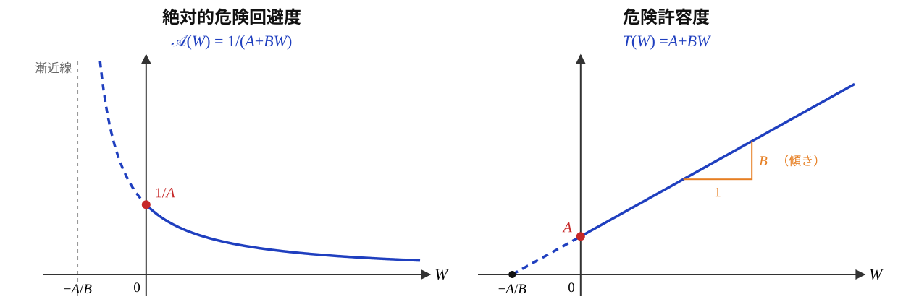

---

# HARA 型効用関数の導出

絶対的危険回避度の定義は $\mathcal{A}(W)=-\frac{u''(W)}{u'(W)}$ なので，HARA 型効用関数を具体的に求めるには，
$$
-\frac{u''(W)}{u'(W)}=\frac{1}{A+BW}
$$
を解けばよい．以下，正1次変換の範囲でで簡潔な形に変換したものを「$\sim$」で表す。

**$B\ne0$ の場合**：上式の左辺は $-\frac{u''(W)}{u'(W)}=-\frac{d}{dW}\big(\ln u'(W)\big)$ と書けるので，両辺を積分すると
$$
\begin{align*}
-\ln u'(W)&=\frac1B\ln(A+BW)+K\quad(K:\text{積分定数}) \\
u'(W)&=e^{-K}(A+BW)^{-1/B}\sim(A+BW)^{-1/B}
\end{align*}
$$
さらに，両辺を積分すると

- $B\ne1$ のとき：$u(W)\sim\dfrac{1}{B-1}(A+BW)^{1-(1/B)}$
- $B=1$ のとき：$u(W)\sim\ln(A+W)$

---

これらの関数は，危険回避性を満たす：
$$
u''(W)\sim-(A+BW)^{-(1/B)-1}<0
$$

**$B=0$ の場合**：このとき，$A>0$ であり
$$
-\frac{u''(W)}{u'(W)}=\frac{1}{A}
$$
左辺は $-\frac{u''(W)}{u'(W)}=-\frac{d}{dW}\big(\ln u'(W)\big)$ と書けるので，両辺を積分すると
$$
-\ln u'(W)=\frac{W}{A}+K\iff u'(W)=e^{-K}e^{-W/A}\sim e^{-W/A}
$$
さらに，両辺を積分すると
$$
u(W)\sim-Ae^{-W/A}\sim-e^{-W/A}
$$
この関数は，危険回避性を満たす：
$$
u''(W)\sim-(1/A)\exp\{-(W/A)\}<0
$$

---

以上をまとめると，次のようになる。

**命題1.4**：HARA 型効用関数は，$A+BW>0$ として
$$
\begin{aligned}
&u(W)\sim\frac{1}{B-1}(A+BW)^{1-(1/B)} && (B\ne0,1)&&\textbf{べき型効用}\\
&u(W)\sim\ln(A+W) && (B=1)&&\textbf{対数型効用}\\
&u(W)\sim-e^{-W/A} && (B=0)&&\textbf{指数型効用}
\end{aligned}
$$
の3種類があり，その限界効用は
$$
u'(W)\sim(A+BW)^{-1/B}\ (B\ne0),\qquad u'(W)\sim e^{-W/A}　\ (B=0)
$$

- $B=-1$ のとき，$u(W) \sim -\frac{1}{2}(A-W)^2$ と2次関数となる。

---

HARA 型効用関数の絶対的・相対的危険回避度を微分すると
$$
\begin{align*}
\frac{\partial \mathcal{A}}{\partial W}(W)&=\frac{d}{dW}\Big\{-\frac{u''(W)}{u'(W)}\Big\}=\frac{d}{dW}\left(\frac{1}{A+BW}\right)=-\frac{B}{(A+BW)^2}\lesseqgtr0\iff B\gtreqless0 \\
\frac{\partial \mathcal{R}}{\partial W}(W)&=\frac{d}{dW}\Big\{-\frac{Wu''(W)}{u'(W)}\Big\}=\frac{d}{dW}\left(\frac{W}{A+BW}\right)=\frac{A}{(A+BW)^2}\gtreqless0\iff A\gtreqless0
\end{align*}
$$

| | 正 | ゼロ | 負 |
|:--|:--|:--|:--|
| $B$ | DARA | CARA | IARA |
| $A$ | IRRA | CRRA | DRRA |

- CARA 型効用関数は，$B=0$ のときなので指数型 $u(W)\sim-e^{-W/A}$ のみである。絶対的危険回避度は $\mathcal{A}(W)=1/A$ であり，危険許容度 $T(W)=A$ は富に依存しない。
- CRRA 型効用関数は，対数型とべき型で $A=0$ としたものがある。相対的危険回避度は $\mathcal{R}(W)=1/B$ であり，危険視さんへの投資比率に依存しない。

---

# 【補足】CRRA 型の標準的な書き方と対数型との連続性

ファイナンスの教科書では，CRRA 型効用関数を相対的危険回避度 $\gamma$ を用いて
$$
u(W)=\frac{W^{1-\gamma}-1}{1-\gamma}\quad(\gamma>0,\ \gamma\ne1),\qquad u(W)=\ln W\quad(\gamma=1)
$$
と書くことが多い。HARA 型効用関数の記法との対応は，$A=0$，$B=1/\gamma$ と定めることで
$$
u(W) \sim \frac{(BW)^{1-1/B}}{B-1} \sim \frac{W^{1-\gamma}}{1-\gamma}
$$
となることからわかる。

**$\gamma\to1$ で対数型に収束する**：$W^{1-\gamma}=e^{(1-\gamma)\ln W}$ であるから，$h=1-\gamma\to0$ とすると
$$
u(W) = \frac{W^{1-\gamma}-1}{1-\gamma} = \frac{e^{h\ln W}-1}{h}\ \longrightarrow\ \left.\frac{d}{dh}e^{h\ln W}\right|_{h=0}=\ln W
$$
