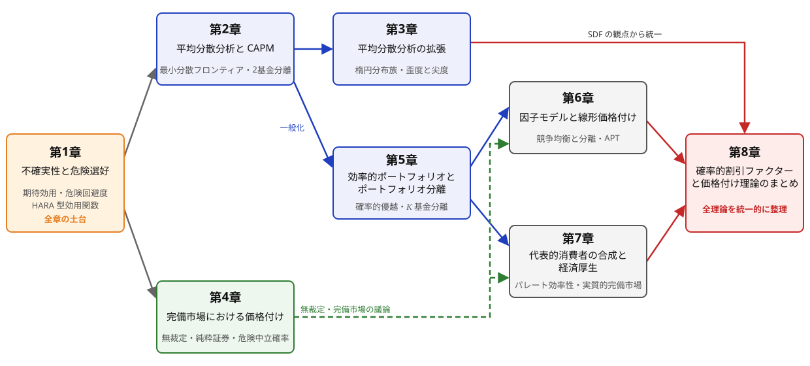
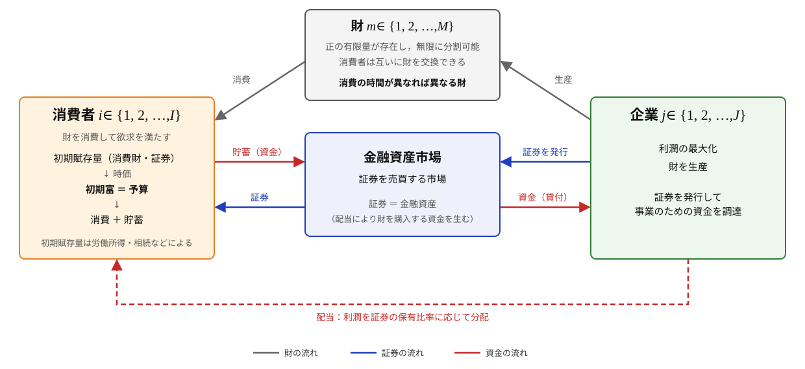
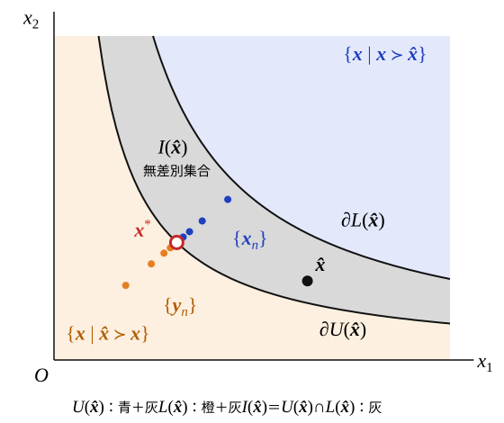
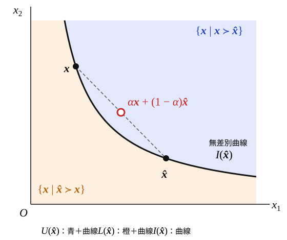
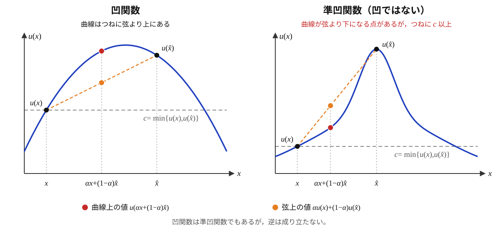
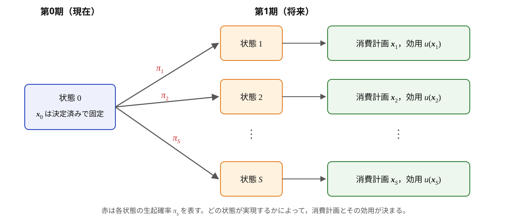
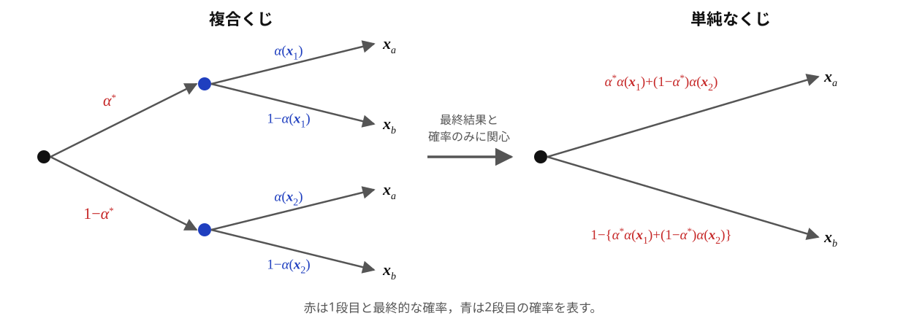

## 金融経済学の基礎 勉強会

### 第1章　不確実性と危険選好

---

# まえがき：本書の目的と位置づけ

**金融経済学（financial economics）** は，不確実性のもとで取引される金融資産の価格がどのように決まるかを，経済主体の合理的な選択行動から説明する理論である。本書の分析対象は**金融資産市場**であり，消費者は将来の不確実な消費を確保するために証券を売買し，企業は事業資金を証券の発行によって調達する。このとき，

- 不確実な将来に対して消費者はどのように選好を表明し，リスクをどう評価するのか，
- その選好のもとで資産の均衡価格はどのような条件をみたすのか，
- 価格付けの諸理論（資本資産価格モデル，裁定価格理論，確率的割引ファクター）は互いにどう関係するのか，

という問いに答えることが本書の目標となる。

本書では，静学的な**2期間モデル**に限定し，情報の非対称性や市場の摩擦を捨象した**競争的完全市場**を前提とすることで，必要な予備知識を最小限に抑える。

> **動学的内容**：池田昌幸 (2000)『オプション評価と企業金融の理論』東京大学出版会

---

# まえがき：各章の関係（図解）

---

# 第1章：本章のねらいと全体像

第1章の目的は，第2章以降の分析に必要な**不確実性下における消費者の選択行動に関する基礎理論**を整理することである。

- **1.1 消費者の選択行動と効用関数**：確実性下の選好を効用関数で表す
- **1.2 期待効用関数**：不確実性下の選好を「効用の期待値」で表す
- **1.3 危険回避と危険プレミアム**：効用関数の「凹凸」で危険回避を表す
- **1.4 絶対的危険回避度と相対的危険回避度**：危険回避の「程度」を測る
- **1.5 危険回避度と危険資産への投資**：危険回避度と消費者の投資行動を結びつける
- **1.6 HARA 型効用関数**：以降の章で頻用される効用関数族を紹介する

---

# 経済の枠組み

- **企業** $j\in\{1,2,\dots,J\}$：利潤の最大化を目的に**財**を生産する。**証券**を発行して事業のための資金を消費者から調達し，証券の保有比率に応じて消費者に利潤を**配当**として分配する。
- **消費者** $i\in\{1,2,\dots,I\}$：財を消費することで自分の欲求を満たすものを想定する。なお，労働所得や相続などにより，あらかじめ消費財や証券を保有していると仮定する。これを**初期賦存量**，その時価を**初期富**という。
  - 初期富を予算として消費を行い，その残余（貯蓄）で証券を購入し企業へ貸し付ける。証券を売買する市場を**金融資産市場**という。証券を保有することで配当により消費のための財を購入する資金が得られるので，証券は**金融資産**とよばれる。
- **財** $m\in\{1,2,\dots,M\}$：正の有限な量が存在して，無限に分割可能とする。消費者は互いに財を交換することができる。ただし不確実性下では，同じ物理的特徴をもつ財でも，**消費の時間が異なれば異なる財**として扱う。

---

# 経済の枠組み（図解）

---

# 1.1 消費者の選択行動と効用関数

消費者 $i$ が計画する $M$ 種類の財の消費量をベクトル
$$
\boldsymbol{x}^i=[x^i_1\ x^i_2\ \cdots\ x^i_M]
$$
で表し，これを消費者 $i$ の**消費計画**という。消費者に経済的制約が存在しないとき，実行可能なすべての消費計画の集合を**消費集合**といい，$X^i$ と表す。

以下，誤解のない場合は添え字 $i$ を省略する。

> なお，現実には経済的な制約，すなわち予算による制約が存在する。

消費者 $i$ は，与えられた複数の消費計画のうち，どの消費計画を望ましく考え，どのように順序付けるのか。この選好の順序付けを表す**選好関係** $\succsim^i$ を定義する。

---

**定義（選好関係）**：2つの消費計画 $\boldsymbol{x},\hat{\boldsymbol{x}}\in X$ に対して，
1. $\boldsymbol{x}\succsim\hat{\boldsymbol{x}}$：$\boldsymbol{x}$ を $\hat{\boldsymbol{x}}$ より同等かそれ以上に望ましいと考えていることを表し，$\boldsymbol{x}$ は $\hat{\boldsymbol{x}}$ に対して**弱く選好される**という。
2. $\boldsymbol{x}\sim\hat{\boldsymbol{x}}$：$\boldsymbol{x}\succsim\hat{\boldsymbol{x}}$ かつ $\hat{\boldsymbol{x}}\succsim\boldsymbol{x}$ が成り立つことを表し，$\boldsymbol{x}$ と $\hat{\boldsymbol{x}}$ は**無差別**であるという。
3. $\boldsymbol{x}\succ\hat{\boldsymbol{x}}$：$\boldsymbol{x}\succsim\hat{\boldsymbol{x}}$ は成り立つが $\hat{\boldsymbol{x}}\succsim\boldsymbol{x}$ は成り立たないことを表し，$\boldsymbol{x}$ は $\hat{\boldsymbol{x}}$ に対して**強く選好される**という。

なお，消費計画を構成する各財は，どんなに多くても量が多いほうが少ないほうより選好されるという**非飽和**の仮定を置くことが多い。したがって，資源に関する制約がなければ非飽和な選好を持つ個人は無限の財を消費することになるが，予算制約が存在するので，そのような事態は一般には起こらない。

---

# 選好の公理

標準的なミクロ経済学では，個人の選択行動（意思決定）を合理的に説明するために，次の3つの性質を公理として仮定する。これらの仮定を満たす関係 $\succsim$ を**2項関係**あるいは**前順序**という。

**仮定1（完備性）**：任意の2つの消費計画 $\boldsymbol{x},\hat{\boldsymbol{x}} \in X$ に対して，以下のいずれかが成立する：
$$
\text{(i)}\ \boldsymbol{x}\succsim\hat{\boldsymbol{x}}\qquad
\text{(ii)}\ \hat{\boldsymbol{x}}\succsim\boldsymbol{x}\qquad
\text{(iii)}\ \boldsymbol{x}\sim\hat{\boldsymbol{x}}
$$

**仮定2（推移性）**：任意の3つの消費計画 $\boldsymbol{x},\hat{\boldsymbol{x}},\hat{\hat{\boldsymbol{x}}} \in X$ に対して，
$$
\boldsymbol{x}\succsim\hat{\boldsymbol{x}}\ \text{かつ}\ \hat{\boldsymbol{x}}\succsim\hat{\hat{\boldsymbol{x}}}
\ \Longrightarrow\ 
\boldsymbol{x}\succsim\hat{\hat{\boldsymbol{x}}}
$$

**仮定3（反射性）**：任意の消費計画 $\boldsymbol{x} \in X$ に対して，$\boldsymbol{x}\sim\boldsymbol{x}$ が成り立つ。

- **完備性**：すべての消費計画が比較可能である。
- **推移性**：消費計画に対する比較を繰り返しても矛盾のない順序付けができる。
- **反射性**：同一の消費計画は自分自身と無差別である（完備性で $\hat{\boldsymbol{x}}=\boldsymbol{x}$ とすれば導かれる）。

---

さらに，仮定1〜3に加えて，以下の**技術的仮定**を置く。この仮定は選好の**連続性**ともよばれ，「少しだけ消費計画を変えても選好は急に逆転しない」ことを表す。

**仮定4（技術的仮定）**：任意の消費計画 $\hat{\boldsymbol{x}} \in X$ に対して，

- $\hat{\boldsymbol{x}}$ と同等かそれ以上に選好されるすべての消費計画からなる**優越消費集合** $\{\boldsymbol{x}\mid\boldsymbol{x}\succsim\hat{\boldsymbol{x}}\}$
- $\hat{\boldsymbol{x}}$ より選好されることがないすべての消費計画からなる**劣等消費集合** $\{\boldsymbol{x}\mid\hat{\boldsymbol{x}}\succsim\boldsymbol{x}\}$

は閉集合である。

この仮定から，消費計画 $\hat{\boldsymbol{x}} \in X$ が与えられたとき， $\hat{\boldsymbol{x}}$ と**無差別な消費計画の集合**が定義できる。

---

# 【補足】仮定4の意味について

**定義（閉集合）**：集合 $S\subseteq\mathbb{R}^M$ が**閉集合**であるとは，$S$ 内の点列 $\{\boldsymbol{x}_n\}$ が $n \to \infty$ で $\boldsymbol{x}_n\to \boldsymbol{x}^*$ と収束するならば，必ず $\boldsymbol{x}^*\in S$ となることをいう。

優越消費集合を $U(\hat{\boldsymbol{x}}):=\{\boldsymbol{x}\mid \boldsymbol{x}\succsim \hat{\boldsymbol{x}}\}$，劣等消費集合を $L(\hat{\boldsymbol{x}}):=\{\boldsymbol{x}\mid \hat{\boldsymbol{x}}\succsim \boldsymbol{x}\}$ とおくと，仮定4は次の2条件と同値である：
$$
\boldsymbol{x}_n\succsim \hat{\boldsymbol{x}}\ (\forall n),\ \boldsymbol{x}_n\to \boldsymbol{x}^*\ \Longrightarrow\ \boldsymbol{x}^*\succsim \hat{\boldsymbol{x}}
$$
$$
\hat{\boldsymbol{x}}\succsim \boldsymbol{x}_n\ (\forall n),\ \boldsymbol{x}_n\to \boldsymbol{x}^{**}\ \Longrightarrow\ \hat{\boldsymbol{x}}\succsim \boldsymbol{x}^{**}
$$

ここで，$\hat{\boldsymbol{x}}$ と無差別な消費計画の集合 $I(\hat{\boldsymbol{x}})=\{\boldsymbol{x}\mid \boldsymbol{x}\sim \hat{\boldsymbol{x}}\}=U(\hat{\boldsymbol{x}})\cap L(\hat{\boldsymbol{x}})$ を考える。$I(\hat{\boldsymbol{x}})$ は，2つの閉集合の共通部分なので，$X$ の中で閉集合である。

---

**命題**：優越消費集合の境界上の点は，すべて $\hat{\boldsymbol{x}}$ と無差別である。つまり，
$$
\partial U(\hat{\boldsymbol{x}})\subseteq I(\hat{\boldsymbol{x}})
$$

**証明**：$\boldsymbol{x}^*\in\partial U(\hat{\boldsymbol{x}})$ とする。

- $\boldsymbol{x}^*$ は $U(\hat{\boldsymbol{x}})$ の境界の点なので，$U(\hat{\boldsymbol{x}})$ 内の点列 $\{\boldsymbol{x}_n\}$ で $\boldsymbol{x}_n\to \boldsymbol{x}^*$ となるものがとれる。$U(\hat{\boldsymbol{x}})$ は閉集合なので $\boldsymbol{x}^* \in U(\hat{\boldsymbol{x}})$ であり，$\boldsymbol{x}^*\succsim \hat{\boldsymbol{x}}$。
- 同様に，$\boldsymbol{x}^*$ は $U(\hat{\boldsymbol{x}})$ の境界の点なので，$U(\hat{\boldsymbol{x}})$ 外の点列 $\{\boldsymbol{y}_n\}$ で $\boldsymbol{y}_n\to \boldsymbol{x}^*$ となるものがとれる。$\boldsymbol{y}_n\notin U(\hat{\boldsymbol{x}})$ と完備性より $\hat{\boldsymbol{x}}\succ\boldsymbol{y}_n$ なので，$\boldsymbol{y}_n\in L(\hat{\boldsymbol{x}})$ である。$L(\hat{\boldsymbol{x}})$ は閉集合なので，$\boldsymbol{x}^*\in L(\hat{\boldsymbol{x}})$ であり，$\hat{\boldsymbol{x}}\succsim \boldsymbol{x}^*$。

以上より，$\boldsymbol{x}^*\sim \hat{\boldsymbol{x}}$ が成り立つので，$\boldsymbol{x}^*\in I(\hat{\boldsymbol{x}})$ である。 $\blacksquare$

この命題と同様に，劣等消費集合の境界上の点もすべて $\hat{\boldsymbol{x}}$ と無差別である。つまり，
$$
\partial L(\hat{\boldsymbol{x}})\subseteq I(\hat{\boldsymbol{x}})
$$

---

---

# 効用関数

仮定1〜4のもとで，消費者の選好関係 $\succsim$ を表現する方法として，消費集合の中から2つずつの消費計画を選んで比較し，選好される方に大きい実数を割り当て，無差別な消費計画には同じ実数を割り当てることで，消費計画に対して実数値を対応させる写像を考えることができる。

このことは，以下の**Debreu の定理**として知られている。

**定理（効用関数の存在）**：$X \subseteq \mathbb{R}^M$ とする。仮定1〜4のもとで，$X$ 上の連続な実数値関数 $u(\cdot)$ が存在して
$$
u(\boldsymbol{x})\geqq u(\hat{\boldsymbol{x}})\iff\boldsymbol{x}\succsim\hat{\boldsymbol{x}},
\quad\forall\,\boldsymbol{x},\hat{\boldsymbol{x}}\in X
$$
が成り立つ。この関数 $u(\cdot)$ を**効用関数**という。

> **参考**：G. Debreu, "Representation of a Preference Ordering by a Numerical Function", 1954.
> J.-Y. Jaffray, "Existence of a Continuous Utility Function: An Elementary Proof", 1975.

---

効用関数はただ1つだけ存在するわけではない。実際，$u$ が効用関数なら，任意の狭義単調増加関数 $f$ に対して，合成関数 $f \circ u$ も効用関数である：
$$
\boldsymbol{x}\succsim\hat{\boldsymbol{x}}
\iff u(\boldsymbol{x})\geqq u(\hat{\boldsymbol{x}})
\iff f(u(\boldsymbol{x}))\geqq f(u(\hat{\boldsymbol{x}}))
$$

2つの消費計画に対して，効用関数の値の大小の順序付けのみが意味をもち，効用関数の値の差や比率には意味がない。このように，順序のみに意味を持つ効用関数を**序数的効用関数**という。

**参考**：もし $X$ が可算集合なら，仮定1〜3だけで効用関数を構成することができる。実際，$X=\{\boldsymbol{x}_n\}_{n=1}^{\infty}$ を可算集合とするとき，関数 $u(\cdot)$ を次で定義する：
$$
u(\boldsymbol{x})=\sum_{n:\ \boldsymbol{x}_n\prec\boldsymbol{x}}2^{-n}
$$
- $\boldsymbol{x}\succsim\boldsymbol{y}$ のとき，推移律より $\boldsymbol{y}\succsim\boldsymbol{x}_n\Rightarrow\boldsymbol{x}\succsim\boldsymbol{x}_n$ で和をとる集合が包含され $u(\boldsymbol{x})\geqq u(\boldsymbol{y})$。
- $\boldsymbol{x}\succ\boldsymbol{y}$ なら，上記に加え $\boldsymbol{y}=\boldsymbol{x}_m$ が $\boldsymbol{y}$ の和には入らず $u(\boldsymbol{x})\geqq u(\boldsymbol{y})+2^{-m}>u(\boldsymbol{y})$。
- 完備性より，$\boldsymbol{x}\succsim\boldsymbol{y}$ でなければ $\boldsymbol{y}\succ\boldsymbol{x}$ である。よって，$u(\boldsymbol{x})\geqq u(\boldsymbol{y})\iff\boldsymbol{x}\succsim\boldsymbol{y}$。 $\blacksquare$

---

# 【補足】辞書式選好

$X$ が可算集合ではなく $X=\mathbb{R}^M$ のような非可算集合の場合には，**仮定4が本質的に必要**である。

**例（辞書式選好）**：$X=\mathbb{R}^2$ 上の選好関係を次で定義する：
$$
\boldsymbol{x}\succ\boldsymbol{y}
\iff x_1>y_1\ \text{または}\ (x_1=y_1\ \text{かつ}\ x_2>y_2)
$$
この選好関係は仮定1〜3を満たすが，これを表現する効用関数は存在しない。

**証明**：効用関数 $u$ があると仮定する。各 $r\in\mathbb{R}$ に対して，$(r,1)\succ(r,0)$ より $u(r,1)>u(r,0)$ であるから，実数の連続性より有理数 $q(r)\in\big(u(r,0),u(r,1)\big)$ が取れる。$r<r'$ のとき，$(r',0)\succ(r,1)$ より $u(r,1)<u(r',0)$ であるから，区間 $\big(u(r,0),u(r,1)\big)$ と $\big(u(r',0),u(r',1)\big)$ は互いに素で $q(r)\neq q(r')$。すると，$q:\mathbb{R}\to\mathbb{Q}$ は単射となるが，$\mathbb{R}$ は非可算，$\mathbb{Q}$ は可算なので矛盾。 $\blacksquare$

なお，辞書式選好は仮定4を満たさない。実際，
$$
\{\boldsymbol{x}\mid\boldsymbol{x}\succsim(0,0)\}=\{(x_1,x_2)\mid x_1>0\}\cup\{(0,x_2)\mid x_2\geqq 0\}
$$ 
は閉集合でない（点列 $\boldsymbol{x}_n=(1/n,-1)$ の極限を考えればよい）。

---

# 狭義凸選好

本書では，仮定1〜4に加えて，消費者の選好が**狭義凸**であると仮定する。

**仮定5（狭義凸選好）**：任意の異なる2つの消費計画 $\boldsymbol{x},\hat{\boldsymbol{x}} \in X$ が $\boldsymbol{x}\sim\hat{\boldsymbol{x}}$ ならば，$0<\alpha<1$ を満たす任意の実数 $\alpha$ に対して，
$$
\alpha\boldsymbol{x}+(1-\alpha)\hat{\boldsymbol{x}}\succ\boldsymbol{x}
$$

- **狭義凸選好**：両極端の選択肢よりも**平均的な選択肢を好む**ことを表す。
- 任意に実数 $\alpha$ がとれるのは，財が完全に分割可能であることを意味する。

仮定5を効用関数の言葉で表すと，任意の異なる2つの消費計画 $\boldsymbol{x},\hat{\boldsymbol{x}} \in X$ に対して，
$$
u(\boldsymbol{x})=u(\hat{\boldsymbol{x}})
\ \Longrightarrow\ 
u(\alpha\boldsymbol{x}+(1-\alpha)\hat{\boldsymbol{x}})>u(\boldsymbol{x}),
\quad\forall\alpha\in(0,1)
$$
が成り立つ。この性質をもつ関数を**狭義準凹関数**という。効用関数が狭義準凹ならば，消費者の選択行動に予算制約を課したとき最適な消費計画を一意に定めることができるメリットがある。

---

---

# 【補足】凹関数と準凹関数

**定義（凹関数と準凹関数）**：
(1) 関数 $u:X\to\mathbb{R}$ が**凹**であるとは，任意の $\boldsymbol{x},\hat{\boldsymbol{x}}\in X$ と任意の $\alpha\in(0,1)$ に対して，
$$
u(\alpha\boldsymbol{x}+(1-\alpha)\hat{\boldsymbol{x}})\geqq\alpha u(\boldsymbol{x})+(1-\alpha)u(\hat{\boldsymbol{x}})
$$

(2) 関数 $u:X\to\mathbb{R}$ が**準凹**であるとは，任意の $\boldsymbol{x},\hat{\boldsymbol{x}}\in X$ と任意の $\alpha\in(0,1)$ に対して，
$$
u(\alpha\boldsymbol{x}+(1-\alpha)\hat{\boldsymbol{x}})\geqq\min\{u(\boldsymbol{x}),u(\hat{\boldsymbol{x}})\}
$$

- 一般に，凹ならば準凹である。しかし，逆は成り立たない（例：$u(x_1,x_2)=x_1x_2$）。
- **準凹性は単調変換で保たれる**が，凹性は保たれない（例：$u(x_1,x_2)=\sqrt{x_1x_2}$）。

---

---

# 1.2 期待効用関数

不確実性下の消費者の選好を表すために，まずは将来の不確実な状況を定式化する。将来実現しうる状況（経済変数のベクトル）を**状態**という（経済状態，世の中の状態，自然の状態ともいう）。

- **時点**：現在を**第0期**，将来を**第1期**という。
- **状態** $s\in\{1,\dots,S\}$：将来実現しうる状況を表す。とくに断らない限り $S$ は有限とする。
- **生起確率** $\pi_s$：状態 $s$ が実現する確率。
- 現在は不確実性がない状態，すなわちすでに実現した状態とみなし，添え字 $0$ をつけて区別する。

時間が進み，ある1つの状態が実現すると不確実性は消滅すると考える。

---

物理的特性が同じ財でも，利用可能な状態が異なれば異なる財として区別する。これを**条件付き財**という。このとき，現在の財は $M$ 種類，将来の条件付き財は $S\times M$ 種類である。
消費者 $i$ の現在の財に対する消費計画を
$$
\boldsymbol{x}^i_0=[x^i_{01}\ x^i_{02}\ \cdots\ x^i_{0M}]
$$
で表し，将来の財に対する消費計画は，状態 $s$ に応じて
$$
\boldsymbol{x}^i_s=[x^i_{s1}\ x^i_{s2}\ \cdots\ x^i_{sM}]
$$
で表される。ここで $x^i_{sm}$ は，状態 $s$ が実現したときの消費者 $i$ による第 $m$ 財の消費量である。

---

# 状態と消費計画（図解）

---

本節では，現在の消費計画は $\boldsymbol{x}^i_0$ に決定済みとして固定し，将来の消費計画 $\boldsymbol{x}^i_s$ がもたらす効用 $u^i(\boldsymbol{x}^i_s)$ を分析する。不確実性下で消費計画を順序付けるには，次の2つの要素が必要である。

1. 各状態における消費計画に対する**嗜好の評価**
2. どの状態が実現するかについての**確率の判断**

この2つを分離して分析するには，消費者の選択行動に強い制約が必要であるように思える。

von Neumann and Morgenstern (1944) は，仮定1〜5に加えて，次の仮定6〜8という**弱い制約を課すだけで十分**であることを示した。

---

**仮定6（連続性）**：任意の異なる3つの消費計画 $\boldsymbol{x},\hat{\boldsymbol{x}},\hat{\hat{\boldsymbol{x}}}\in X$ に対して，ある $\alpha\in(0,1)$ がただ1つ存在して，
$$
\boldsymbol{x}\succ\hat{\boldsymbol{x}}\succ\hat{\hat{\boldsymbol{x}}}\ \Longrightarrow \ 
\hat{\boldsymbol{x}}\sim\alpha\boldsymbol{x}+(1-\alpha)\hat{\hat{\boldsymbol{x}}}
$$ 

**仮定7（独立性）**：任意の異なる2つの消費計画 $\boldsymbol{x},\hat{\boldsymbol{x}}\in X$ が $\boldsymbol{x}\succsim\hat{\boldsymbol{x}}$ ならば，第3の消費計画 $\hat{\hat{\boldsymbol{x}}} \in X$ と任意の $\alpha\in(0,1)$ に対して，
$$
\alpha\boldsymbol{x}+(1-\alpha)\hat{\hat{\boldsymbol{x}}}\succsim\alpha\hat{\boldsymbol{x}}+(1-\alpha)\hat{\hat{\boldsymbol{x}}}
$$

**仮定8（単調性）**：任意の異なる2つの消費計画 $\boldsymbol{x},\hat{\boldsymbol{x}}\in X$ が $\boldsymbol{x}\succ\hat{\boldsymbol{x}}$ ならば，任意の $\alpha_1,\alpha_2\in(0,1)$ に対して，
$$
\alpha_1\boldsymbol{x}+(1-\alpha_1)\hat{\boldsymbol{x}}\succsim\alpha_2\boldsymbol{x}+(1-\alpha_2)\hat{\boldsymbol{x}}\iff\alpha_1\geqq\alpha_2
$$

---

- **連続性**：**アルキメデスの公理**ともよばれる。$\alpha$ は，$\boldsymbol{x}$ と $\hat{\hat{\boldsymbol{x}}}$ を凸結合により組み合わせて，両者の中間にある $\hat{\boldsymbol{x}}$ と無差別な消費計画を作るための比率と解釈できる。
- **独立性**：2つの消費計画の選好順序は，共通の第3の消費計画と組み合わせても変わらない。つまり，異なる消費計画の間に補完性や代替性がないことを仮定している。
- **単調性**：選好順序が高い消費計画へのウェイトが大きいほど，合成された消費計画は強く選好される。

> **注意**：教科書の仮定8では $\boldsymbol{x}\succsim\hat{\boldsymbol{x}}$ と書かれている。しかし，$\boldsymbol{x}\sim\hat{\boldsymbol{x}}$ のときは，$\alpha_1<\alpha_2$ であっても2つのくじが無差別となり，$\succsim$ が成り立つ。つまり，「$\Rightarrow$」が成り立たない。そこで，ここでは $\succ$ としている。

> **参考**：標準的な教科書では，単調性は連続性と独立性から導かれる性質として扱われる。なお，その場合，独立性は次のように仮定される：
> $$
> \boldsymbol{x}\succsim\hat{\boldsymbol{x}}\ \Longleftrightarrow\ \alpha\boldsymbol{x}+(1-\alpha)\hat{\hat{\boldsymbol{x}}}\succsim\alpha\hat{\boldsymbol{x}}+(1-\alpha)\hat{\hat{\boldsymbol{x}}}
> $$

---

# 期待効用関数

以上の追加的仮定のもとで，不確実な消費計画に対する消費者 $i$ の選好は，**期待効用関数**
$$
\sum_{s=1}^{S}\pi^i_s\,u^i_s(\boldsymbol{x}^i_s)
$$
によって完全に表現できる（Mas-Colell, Whinston and Green (1995), 第6章）。

- $\boldsymbol{x}^i_s=[x^i_{s1}\ x^i_{s2}\ \cdots\ x^i_{sM}]$ は状態 $s$ における $M$ 種類の財の消費計画である。
- $u^i_s(\cdot)$ は効用関数であり，期待効用関数と区別することを強調したいときには，特に**基礎的効用関数**という。また，異なる状態間で効用関数 $u^i_s(\cdot)$ が加法的であると仮定している。
- $\pi^i_s$ は状態 $s$ が実現する確率であり，Savage (1954) では消費者 $i$ の**主観的確率**とよばれる。各消費者 $i \in \{1,\ldots,I\}$ に対して，次が成り立つ：
$$
\pi^i_s\geqq 0,\quad \forall s \in \{1,\ldots,S\},\qquad \sum_{s=1}^S \pi^i_s=1
$$

---

- von Neumann and Morgenstern (1944) では，すべての消費者で生起確率は共通であると仮定されており，**客観的確率**とよばれる：
$$
\pi^i_s=\pi_s,\quad \forall i \in \{1,\ldots,I\}
$$
- 通常の分析では，基礎的効用関数は**状態から独立**であると仮定される：
$$
u^i_s(\boldsymbol{x}^i_s)=u^i(\boldsymbol{x}^i_s),\quad \forall s \in \{1,\ldots,S\}
$$

いずれの立場でも，期待効用関数は状態の確率 $\pi$ をウェイトとする基礎的効用関数の凸結合で表される。では，以上の仮定1〜8のもとで，期待効用関数がどのように導かれるかを説明する。
<!-- なお，以下の導出はFama and Miller (1972) に従う。 -->

> **参考**：[1] L. J. Savage, "The Foundations of Statistics", 1954.
> [2] F. J. Anscombe and R. J. Aumann, "A Definition of Subjective Probability", 1963.
> [3] E. Karni, "Decision Making under Uncertainty: The Case of State-Dependent Preferences", 1985.
> [4] J. von Neumann and O. Morgenstern, "Theory of Games and Economic Behavior", 1944.

---

将来の状態が2通りの場合（$S=2$）を考える。$\alpha \in (0,1)$ とし，確率 $\alpha$ で $\boldsymbol{x}_1$，確率 $1-\alpha$ で $\boldsymbol{x}_2$ の消費が行われる確率的な消費計画を考える（これは**確率くじ**とみなせる）。このような消費計画を $L(\boldsymbol{x}_1,\boldsymbol{x}_2: \alpha)$ と書く。このとき，仮定6〜8は次のように書ける。

**仮定6'（連続性）**：任意の異なる $\boldsymbol{x},\boldsymbol{x}_1,\boldsymbol{x}_2\in X$ に対して，$\alpha\in(0,1)$ がただ1つ存在して，
$$
\boldsymbol{x}_1\succ\boldsymbol{x}\succ\boldsymbol{x}_2\ \Longrightarrow \ 
\boldsymbol{x}\sim L(\boldsymbol{x}_1,\boldsymbol{x}_2:\alpha)
$$ 

**仮定7'（独立性）**：任意の異なる2つの $\boldsymbol{x}_1,\boldsymbol{x}_1^{\prime}\in X$ が $\boldsymbol{x}_1\succsim\boldsymbol{x}_1^{\prime}$ ならば，任意の $\boldsymbol{x}_2 \in X$ と任意の $\alpha\in(0,1)$ に対して，
$$
L(\boldsymbol{x}_1,\boldsymbol{x}_2:\alpha)\succsim L(\boldsymbol{x}_1^{\prime},\boldsymbol{x}_2:\alpha)
$$

**仮定8'（単調性）**：任意の異なる2つの $\boldsymbol{x}_1,\boldsymbol{x}_2\in X$ が $\boldsymbol{x}_1\succ\boldsymbol{x}_2$ ならば，任意の $\alpha_1,\alpha_2\in(0,1)$ に対して，
$$
L(\boldsymbol{x}_1,\boldsymbol{x}_2:\alpha_1)\succsim L(\boldsymbol{x}_1,\boldsymbol{x}_2:\alpha_2)
\iff\alpha_1\geqq\alpha_2
$$

---

# 期待効用関数の導出

以下は Fama and Miller (1972) を修正したものである。
実現可能な消費計画集合 $X$ において，最も選好される消費計画を $\boldsymbol{x}_a$，最も選好されない消費計画を $\boldsymbol{x}_b$ とする：
$$
\boldsymbol{x}_a\succsim\boldsymbol{x}\succsim\boldsymbol{x}_b,
\qquad\forall\boldsymbol{x}\in X
$$
**仮定6'（連続性）** より，任意の $\boldsymbol{x} \in X$ に対して，
$$
\boldsymbol{x}\sim L(\boldsymbol{x}_a,\boldsymbol{x}_b:\alpha)
$$
を満たす確率 $\alpha \in (0,1)$ がただ1つ存在する。これを $\alpha=\alpha(\boldsymbol{x})$ と書く。これより，任意の $\boldsymbol{x}_1,\boldsymbol{x}_2\in X$ に対して，
$$
\boldsymbol{x}_1\sim L(\boldsymbol{x}_a,\boldsymbol{x}_b:\alpha(\boldsymbol{x}_1)),\qquad
\boldsymbol{x}_2\sim L(\boldsymbol{x}_a,\boldsymbol{x}_b:\alpha(\boldsymbol{x}_2))
$$

> $\alpha(\boldsymbol{x})$ は，$\boldsymbol{x}$ を確実に得ることと，確率 $\alpha$ で最良，確率 $1-\alpha$ で最悪となるくじを無差別にする確率である。また，$\alpha(\boldsymbol{x}_a)=1$，$\alpha(\boldsymbol{x}_b)=0$ と定める。

---

**仮定8'（単調性）** と**仮定2（推移性）** より，
$$
\alpha(\boldsymbol{x}_1)\geqq\alpha(\boldsymbol{x}_2)\iff L(\boldsymbol{x}_a,\boldsymbol{x}_b:\alpha(\boldsymbol{x}_1))\succsim L(\boldsymbol{x}_a,\boldsymbol{x}_b:\alpha(\boldsymbol{x}_2))\iff\boldsymbol{x}_1\succsim\boldsymbol{x}_2
$$
したがって，$\alpha(\cdot)$ は確実な消費計画の選好順序を保存する関数，すなわち**効用関数**である。

あとは，確率くじの順序付けが $\alpha(\cdot)$ の期待値で行えることを示せばよい。ここで，確率くじ $L=L(\boldsymbol{x}_1,\boldsymbol{x}_2:\alpha^*)$ を考える。$\boldsymbol{x}_a\succ L\succ\boldsymbol{x}_b$ とすると，**仮定6'（連続性）** より
$$
L(\boldsymbol{x}_1,\boldsymbol{x}_2:\alpha^*)\sim L(\boldsymbol{x}_a,\boldsymbol{x}_b:\alpha(L))
$$
を満たす $\alpha(L)=\alpha(L(\boldsymbol{x}_1,\boldsymbol{x}_2:\alpha^*))$ がただ1つ存在する。また，$\boldsymbol{x}_1\sim L(\boldsymbol{x}_a,\boldsymbol{x}_b:\alpha(\boldsymbol{x}_1))$ なので，**仮定7'（独立性）** より，
$$
L(\boldsymbol{x}_1,\boldsymbol{x}_2:\alpha^*)
\sim L\big(L(\boldsymbol{x}_a,\boldsymbol{x}_b:\alpha(\boldsymbol{x}_1)),\ \boldsymbol{x}_2:\alpha^*\big)
\sim L\big(L(\boldsymbol{x}_a,\boldsymbol{x}_b:\alpha(\boldsymbol{x}_1)),\ L(\boldsymbol{x}_a,\boldsymbol{x}_b:\alpha(\boldsymbol{x}_2)):\alpha^*\big)
$$
**仮定2（推移性）** より，これら3つのくじはすべて無差別であるから，
$$
L(\boldsymbol{x}_1,\boldsymbol{x}_2:\alpha^*)
\sim L\big(L(\boldsymbol{x}_a,\boldsymbol{x}_b:\alpha(\boldsymbol{x}_1)),\ L(\boldsymbol{x}_a,\boldsymbol{x}_b:\alpha(\boldsymbol{x}_2)):\alpha^*\big)
$$

---

$\triangleright$ $L(\boldsymbol{x}_1,\boldsymbol{x}_2:\alpha^*) \sim L\big(L(\boldsymbol{x}_a,\boldsymbol{x}_b:\alpha(\boldsymbol{x}_1)),\ L(\boldsymbol{x}_a,\boldsymbol{x}_b:\alpha(\boldsymbol{x}_2)):\alpha^*\big)$

右辺は，くじを賞品とするくじ（**複合くじ**）を表している。例えば，最終的に $\boldsymbol{x}_a$ が得られる確率は，
$$
\alpha^*\cdot\alpha(\boldsymbol{x}_1)+(1-\alpha^*)\cdot\alpha(\boldsymbol{x}_2)
$$
である。消費者が**最終結果とその最終的な確率のみ**に関心をもつならば，
$$
L(\boldsymbol{x}_1,\boldsymbol{x}_2:\alpha^*)
\sim L\big(\boldsymbol{x}_a,\boldsymbol{x}_b:\alpha^*\alpha(\boldsymbol{x}_1)+(1-\alpha^*)\alpha(\boldsymbol{x}_2)\big)
$$
が成り立つ。ところで，上記の議論から
$$
L(\boldsymbol{x}_1,\boldsymbol{x}_2:\alpha^*)\sim L(\boldsymbol{x}_a,\boldsymbol{x}_b:\alpha(L))
$$
だったので，$\alpha(L)$ の**一意性**より，
$$
\boxed{\ \alpha\big(L(\boldsymbol{x}_1,\boldsymbol{x}_2:\alpha^*)\big)=\alpha^*\alpha(\boldsymbol{x}_1)+(1-\alpha^*)\alpha(\boldsymbol{x}_2)\ }
$$

---

# 複合くじの還元（図解）

> **補足**：最終的な確率のみに依存するという仮定は**複合くじの還元公理**とよばれ，教科書では暗黙に置かれている。人がくじの「段階」を気にする場合には成り立たない。

---

$\triangleright$ $\alpha\big(L(\boldsymbol{x}_1,\boldsymbol{x}_2:\alpha^*)\big)=\alpha^*\alpha(\boldsymbol{x}_1)+(1-\alpha^*)\alpha(\boldsymbol{x}_2)$

上式は，くじを $\alpha(\cdot)$ で評価した値が各結果の $\alpha(\cdot)$ を確率で加重平均したもの，すなわち $\alpha(\cdot)$ の期待値に等しいことを示している。よって，くじの順序付けは期待効用による順序付けと一致する。 $\blacksquare$

| 公理 | 導出での役割 |
|:--|:--|
| 連続性 | 目盛り $\alpha(\boldsymbol{x})$ の存在と一意性 |
| 単調性 | $\alpha(\cdot)$ が選好順序を保存（効用関数になる） |
| 独立性 | 結果を無差別なくじで置き換えてよい |
| 推移性 | 置き換えた複数のくじがすべて無差別 |

> **補足**：結果が $n$ 個のくじも，「確率 $p_1$ で $\boldsymbol{x}_1$，残りの確率で $\boldsymbol{x}_2,\dots,\boldsymbol{x}_n$ の条件付きくじ」と分解して帰納法を使えば，同様に $\alpha(L)=\sum_k p_k\,\alpha(\boldsymbol{x}_k)$ が示せる。

---

# 【補足】独立性への反例：Allais のパラドックス

仮定7'（独立性）は，実験的に反例が知られている（Allais (1953)）。

**仮定7'（独立性）**：任意の異なる2つの $\boldsymbol{x}_1,\boldsymbol{x}_1^{\prime}\in X$ が $\boldsymbol{x}_1\succsim\boldsymbol{x}_1^{\prime}$ ならば，任意の $\boldsymbol{x}_2 \in X$ と任意の $\alpha\in(0,1)$ に対して，
$$
L(\boldsymbol{x}_1,\boldsymbol{x}_2:\alpha)\succsim L(\boldsymbol{x}_1^{\prime},\boldsymbol{x}_2:\alpha)
$$

確率 $\alpha$ で賞金 $x_1$，確率 $1-\alpha$ で賞金 $x_2$ が得られるくじを $L(x_1,x_2:\alpha)$ とし，次の5つのくじを考える。
$$
\begin{aligned}
&L_0=L(10\text{万円},0\text{万円}:0),\quad L_1=L(10\text{万円},0\text{万円}:0.1),\quad L_2=L(15\text{万円},0\text{万円}:0.09),\\
&L_3=L(10\text{万円},0\text{万円}:1),\quad L_4=L(15\text{万円},0\text{万円}:0.9)
\end{aligned}
$$
例えば，$L_3$ は確実に10万円が得られ，$L_0$ は確実に何も得られない特殊なくじである。実験では，**$L_2\succ L_1$ かつ $L_3\succ L_4$** という選好を示す人が多いことが知られている。

---

これらのくじを期待効用で評価すると，
$$
\begin{align*}
E[u(L_0)]&=0 \cdot u(10\text{万円})+1 \cdot u(0\text{万円})= u(0\text{万円})\\
E[u(L_3)]&=1 \cdot u(10\text{万円})+0 \cdot u(0\text{万円})= u(10\text{万円})\\
E[u(L_1)]&=0.1 \cdot u(10\text{万円})+0.9 \cdot u(0\text{万円})=0.1 \cdot E[u(L_3)]+0.9 \cdot E[u(L_0)]
\end{align*}
$$
より $L_1\sim L(L_3,L_0:0.1)$ である。同様に，
$$
\begin{align*}
E[u(L_4)]&=0.9 \cdot u(15\text{万円})+0.1 \cdot u(0\text{万円})\\
E[u(L_2)]&=0.09 \cdot u(15\text{万円})+0.91 \cdot u(0\text{万円})\\
&=0.1(0.9 \cdot u(15\text{万円})+0.1 \cdot u(0\text{万円}))+0.9 \cdot u(0\text{万円})\\
&=0.1 \cdot E[u(L_4)]+0.9 \cdot E[u(L_0)]
\end{align*}
$$
より $L_2\sim L(L_4,L_0:0.1)$ である。したがって，もし $L_3\succ L_4$ ならば，**独立性**より
$$
L(L_3,L_0:0.1)\succ L(L_4,L_0:0.1)
$$
すなわち $L_1\succ L_2$ が成り立つはずである。これは，実験結果の $L_2\succ L_1$ と**矛盾**する。 $\blacksquare$

---

Allais の反例の主張を言い換えると，多くの人が示す2つの選好はどんな効用関数 $u$ を選んでも期待効用では同時に説明できないことを意味する。ここで，効用関数は $u(0)=0$ と基準化しても一般性を失わない。以下，単位は万円とする。

- $L_3\succ L_4$：$u(10)>0.9\,u(15)$
- $L_2\succ L_1$：$0.09\,u(15)>0.1\,u(10)$，すなわち $0.9\,u(15)>u(10)$

この2つの不等式を同時に満たす関数 $u$ は存在しない。

- **$L_3$ と $L_4$ の比較**：確実に10万円が得られることは非常に魅力的である（**確実性効果**）。
- **$L_1$ と $L_2$ の比較**：当たる確率はどちらも低く，0.10 と 0.09 の差は小さく感じるので，賞金が大きいほうを選ぶ。
<!-- - **期待効用との関係**：期待効用は確率について線形なので，確率を10分の1に縮めても選好は逆転しない。 -->

> **参考**：このような反例は，**プロスペクト理論**（Kahneman–Tversky）など非期待効用理論の動機となった。ただし，本書は期待効用を前提に進む。

---

**命題**：$\alpha(\cdot)$ がある消費者の期待効用関数ならば，その**正1次変換**
$$
U(\cdot)=\gamma_1+\gamma_2\,\alpha(\cdot),\qquad\gamma_2>0
$$
もまた期待効用関数である。また，この変換により，2つのくじの順序付けは保存される。

**証明**：期待効用関数の性質より
$$
\alpha(L(\boldsymbol{x}_1,\boldsymbol{x}_2:\alpha_1))=\alpha_1\alpha(\boldsymbol{x}_1)+(1-\alpha_1)\alpha(\boldsymbol{x}_2)
$$
なので，$\gamma_1=\alpha_1\gamma_1+(1-\alpha_1)\gamma_1$ に注意すると，
$$
\begin{aligned}
U(L(\boldsymbol{x}_1,\boldsymbol{x}_2:\alpha_1))&=\gamma_1+\gamma_2\{\alpha_1\alpha(\boldsymbol{x}_1)+(1-\alpha_1)\alpha(\boldsymbol{x}_2)\}\\
&=\alpha_1\{\gamma_1+\gamma_2\alpha(\boldsymbol{x}_1)\}+(1-\alpha_1)\{\gamma_1+\gamma_2\alpha(\boldsymbol{x}_2)\}\\
&=\alpha_1U(\boldsymbol{x}_1)+(1-\alpha_1)U(\boldsymbol{x}_2)
\end{aligned}
$$
よって，$U$ は期待効用関数の性質を満たす。

---

次に，2つのくじの順序付けが正1次変換によって保存されることを確かめる。もう1つのくじ $L(\boldsymbol{y}_1,\boldsymbol{y}_2:\alpha_2)$ に対して，期待効用関数の性質より
$$
\alpha(L(\boldsymbol{y}_1,\boldsymbol{y}_2:\alpha_2))=\alpha_2\alpha(\boldsymbol{y}_1)+(1-\alpha_2)\alpha(\boldsymbol{y}_2)
$$
である。関数 $U$ で2つのくじを評価すると，
$$
U(L(\boldsymbol{x}_1,\boldsymbol{x}_2:\alpha_1))=\gamma_1+\gamma_2\{\alpha_1\alpha(\boldsymbol{x}_1)+(1-\alpha_1)\alpha(\boldsymbol{x}_2)\}
$$
$$
U(L(\boldsymbol{y}_1,\boldsymbol{y}_2:\alpha_2))=\gamma_1+\gamma_2\{\alpha_2\alpha(\boldsymbol{y}_1)+(1-\alpha_2)\alpha(\boldsymbol{y}_2)\}
$$
$\gamma_2>0$ なので，
$$
\alpha(L(\boldsymbol{x}_1,\boldsymbol{x}_2:\alpha_1))\geqq\alpha(L(\boldsymbol{y}_1,\boldsymbol{y}_2:\alpha_2))\iff U(L(\boldsymbol{x}_1,\boldsymbol{x}_2:\alpha_1))\geqq U(L(\boldsymbol{y}_1,\boldsymbol{y}_2:\alpha_2))
$$
であり，関数 $U$ により順序付けは保存される。 $\blacksquare$

---

# 【補足】効用関数の性質を保存する単調変換は正1次変換のみ

ある効用関数 $u$ が期待効用関数であるとき，任意の単調変換 $v=f(u)$ が期待効用関数であるためには，$f$ は正1次変換でなければならないことを示す。

**命題**：$u$ と $v$ がともに同じ選好を表す期待効用関数ならば，ある $\gamma_1 \in \mathbb{R}$ と $\gamma_2>0$ が存在して，$v=\gamma_1+\gamma_2u$ である。

**証明**：$\boldsymbol{x}_a,\boldsymbol{x}_b$ を最良・最悪の消費計画とし，$\boldsymbol{x}_a\succ\boldsymbol{x}_b$ とする（無差別なら自明）。$u,v$ はともにくじを期待値で評価するので，$u_a=u(\boldsymbol{x}_a)$ などと書くと，
$$
\begin{align*}
u(\boldsymbol{x})&=\alpha(\boldsymbol{x}) \cdot u_a + (1-\alpha(\boldsymbol{x})) \cdot u_b = u_b+(u_a-u_b)\,\alpha(\boldsymbol{x}),\\
v(\boldsymbol{x})&=\alpha(\boldsymbol{x}) \cdot v_a + (1-\alpha(\boldsymbol{x})) \cdot v_b = v_b+(v_a-v_b)\,\alpha(\boldsymbol{x})
\end{align*}
$$
$u_a>u_b$ なので，第1式から $\alpha(\boldsymbol{x})$ を求め，第2式に代入すると，
$$
v(\boldsymbol{x})=\underbrace{v_b-\gamma_2u_b}_{:=\gamma_1}+\underbrace{\frac{v_a-v_b}{u_a-u_b}}_{:=\gamma_2>0}\,u(\boldsymbol{x})\qquad\blacksquare
$$

---

期待効用関数は正1次変換までは一意に定まるが，関数形そのものが一意に定まるわけではない。特に，原点が1つに定まらないので，期待効用の**絶対水準**には意味がなく，異なる消費者間で期待効用を比較することはできない。

しかし，正1次変換で**効用の差の順序**は保存されるので，期待効用の差の大小を比較することはできる：
$$
u(\boldsymbol{x}_1)-u(\boldsymbol{x}_2)\geqq u(\boldsymbol{x}_3)-u(\boldsymbol{x}_4)\iff U(\boldsymbol{x}_1)-U(\boldsymbol{x}_2)\geqq U(\boldsymbol{x}_3)-U(\boldsymbol{x}_4)
$$

効用の数値の加減乗除が実質的な意味をもつ効用関数を**基数的効用関数**という。期待効用関数は，限定された意味で基数的な性質を持つ。

| | 許される変換 | 意味をもつもの |
|:--|:--|:--|
| 序数的効用 | 任意の狭義増加変換 | 大小のみ |
| 期待効用 | 正1次変換のみ | 大小と差の大小 |

---

<!-- # 例1.1：修正セントペテルスブルグの逆説 -->

以上の設定では，期待効用関数が有限であることを仮定している。しかし，状態の数や消費計画が有限でない場合には，期待効用が無限大となるくじを作ることができる。

**例1.1（修正セントペテルスブルグの逆説）**：偏りのない硬貨を表が出るまで投げ続け，$n$ 回目に初めて表が出たら $2^n$ 円を支払うくじを考える。$n$ 回目に初めて表が出る確率は $p(n)=1/2^n$ より，くじがもたらす収益の期待値は
$$
E[2^{\tilde n}]=\sum_{n=1}^{\infty}2^n\,p(n)=\sum_{n=1}^{\infty}2^n\Big(\frac{1}{2^n}\Big)=\sum_{n=1}^{\infty}1=+\infty\ (\text{円})
$$
このくじの期待値は無限大だが，現実には誰も巨額を払ってこのくじを買おうとはしない。実際，基礎的効用関数が $u(x)=\ln x$ ならば，
$$
E[u(2^{\tilde n})]=\sum_{n=1}^{\infty}(\ln2^n)\Big(\frac{1}{2^n}\Big)=(\ln2)\sum_{n=1}^{\infty}\frac{n}{2^n}=2\ln2=\ln4
$$
となり，このくじの効用は確実に4円がもたらす効用に等しい。

---

期待効用が有限になったのは，効用関数 $u(x)=\ln x$ の凹性による。しかし，効用関数が上に有界でない限り，期待効用が無限大のくじを作れる。例えば，$n$ 回目に初めて表が出たときに $\exp(2^n)$ 円を支払うくじを考えると，対数効用でも
$$
E[u(\exp(2^{\tilde n}))]=\sum_{n=1}^\infty(\ln\exp(2^n))\Big(\frac1{2^n}\Big)=\sum_{n=1}^\infty2^n\Big(\frac1{2^n}\Big)=\sum_{n=1}^\infty1=+\infty
$$
同様に，$\exp(3^n)$ 円，$\exp(4^n)$ 円支払うくじも期待効用は無限大となり，期待効用による順序付けができなくなる。これを**修正セントペテルスブルグの逆説**という。

この問題は，次のいずれかの方法で回避できる。

- **効用関数の制限**：狭義凹の効用関数と，期待値が有限の消費計画を仮定する。
- **消費計画の制限**：消費計画を有界に制限する（状態数 $S$ を有限にすれば有界になる）。

> **補足**：$u$ が上に有界なら，$E[u]\leqq\sup u<\infty$ なので，この種の逆説は生じない。